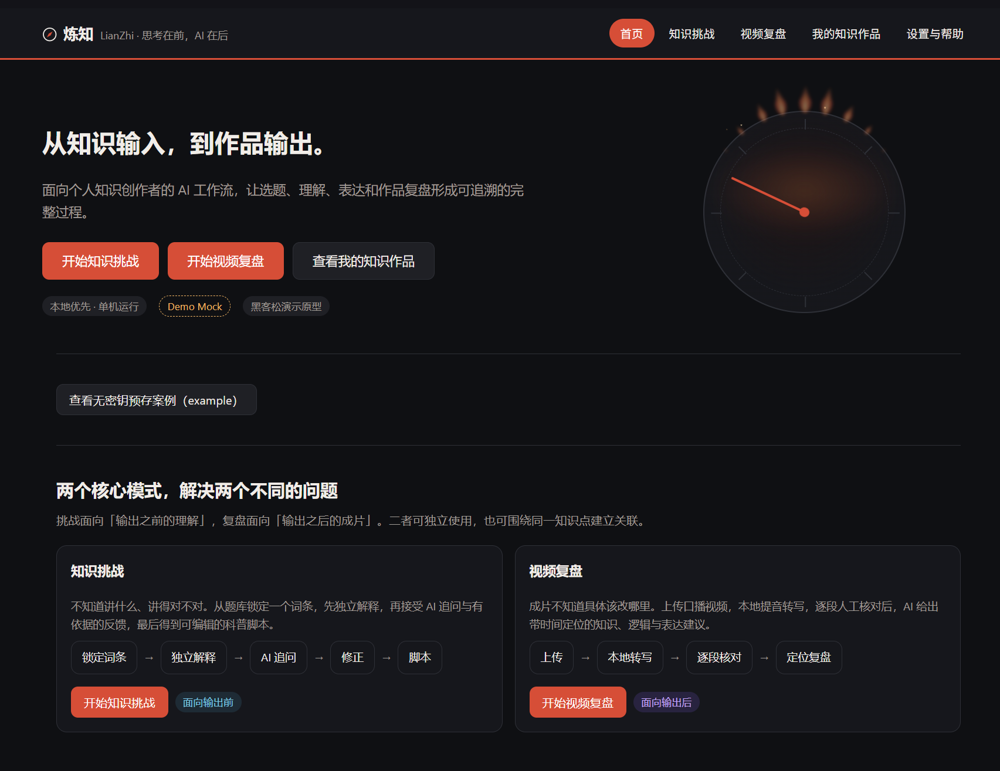
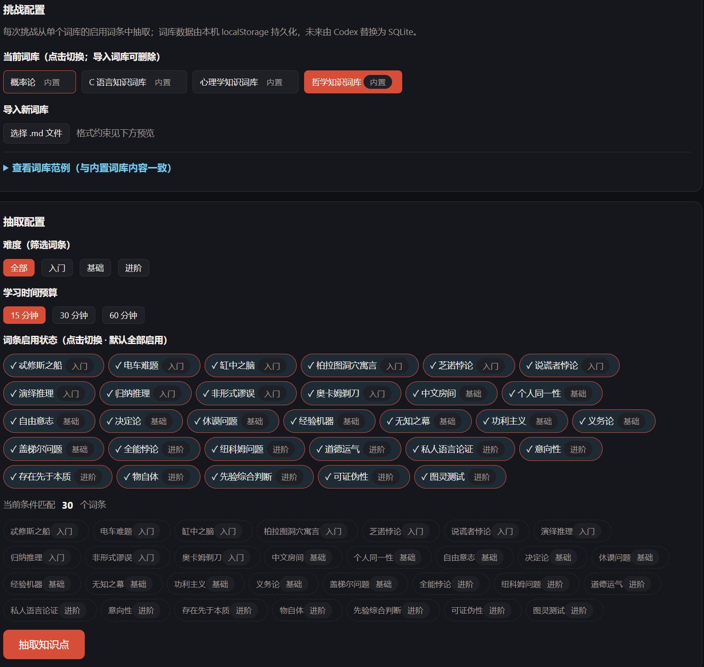
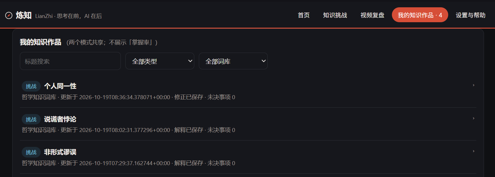
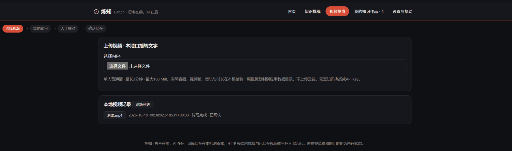

# 炼知 · LianZhi

**先自己讲，再让 AI 追问。**  
*思考在前，AI 在后。*

[](https://github.com/nottobeshy/LianZhi/releases/tag/v0.1.0)

[](LICENSE)

炼知是一款面向知识学习者与个人内容创作者的 Windows 桌面工具。它借鉴费曼学习法的“用自己的语言解释”思路：抽取知识点、限时学习、独立解释，再让 AI 针对表达追问；也可以上传口播视频，本地转写后自主选择是否让云端 AI 给出修改建议。解释、追问和修订过程保存在本机。

> **预览版 v0.1.0**：公开提供 Windows x64 ZIP，目前仅有开发者 Windows 11 x64 环境的桌面验收记录；发行包的完整真实云端 AI 流程尚缺独立验收证据，详见[已知限制](#已知限制)。

<p align="center">
  <a href="assets/screenshots/01-home.png"></a>
</p>
<p align="center"><sub>实际软件首页截图，点击可查看原图。截图中的「Demo Mock」为截取时的演示模式标识，不代表项目仅支持模拟模型。</sub></p>

**[下载 Windows 预览版](https://github.com/nottobeshy/LianZhi/releases/tag/v0.1.0)** · [源代码](https://github.com/nottobeshy/LianZhi) · [使用指南](docs/releases/WINDOWS_QUICKSTART.md)

## 一次学习如何发生？

**选题 → 限时学习 → 独立解释 → AI 追问 → 回答与修正 → 保存作品**

例如，可在哲学词库中选择“个人同一性”，先写下自己的解释，再主动发起追问，保存回答和修正。下面是**真实软件中的挑战配置和作品列表**；这两张图不包含云端模型实际追问，因此不把示例问题冒充真实运行结果。

<table>
  <tr>
    <td width="50%" align="center">
      <a href="assets/screenshots/02-knowledge-challenge.png"></a><br>
      <sub>知识挑战 · 词库与抽题配置（点击放大）</sub>
    </td>
    <td width="50%" align="center">
      <a href="assets/screenshots/04-knowledge-works.png"></a><br>
      <sub>我的知识作品 · 保存与回看（点击放大）</sub>
    </td>
  </tr>
</table>

## 两个工作入口

### 01 · 知识挑战

内置**概率论、C 语言、心理学、哲学**四个词库，支持导入 Markdown 词库；用户设置难度与学习时间后独立解释，再主动授权 AI 提出 1～3 个针对性问题，回答、修正并保存到本地档案。

### 02 · 视频复盘

导入 **MP4（≤180 秒、≤100 MiB）**，由本地 CPU INT8 语音模型转写并生成时间戳分段。人工确认文字后，可授权云端模型提供知识、逻辑与表达建议；原稿、AI 建议稿、用户编辑稿分别保留，便于对照。

<p align="center">
  <a href="assets/screenshots/03-video-review.png"></a>
</p>
<p align="center"><sub>视频复盘真实界面：上传与本地转写入口；这张截图不包含生成后的 AI 文案对照。</sub></p>

### 03 · 我的知识作品

知识挑战和视频复盘记录可在本机保存、查询和回看；已保存的原始表达及后续修订不会被 AI 建议直接覆盖。

## 为什么不直接使用通用大模型？

用 DeepSeek、Kimi 或 ChatGPT 配合一条“请先向我追问”的提示词，也可以获得高质量对话。炼知的区别不是独有的提问算法，而是将学习、表达和复盘组织为可重复的本地工作流。

| 已有方法 | 已能完成的事 | 炼知整合的流程 |
| --- | --- | --- |
| 通用大模型 + 苏格拉底式提示词 | 灵活问答、追问 | 四个内置词库、抽题、学习计时、回答与本地修订档案 |
| 费曼学习法 + 笔记工具 | 独立解释、记录学习 | 把追问、回答和修订串联保存 |
| 视频转写 / 润色工具 | 获取口播文本、修改稿件 | 本地转写、人工确认、版本对照与历史留存 |

如果已经有成熟的提问流程，也不需要记录修订历史，直接使用通用大模型即可。炼知的价值在于固定流程和本地档案；代价是**当前只验证了 Windows 11 x64、需自备云端 API Key，内置词库只有四个**。目前没有教学效果的对照实验数据。

## Windows 快速开始

1. 从 [GitHub Releases](https://github.com/nottobeshy/LianZhi/releases/tag/v0.1.0) 下载 Windows ZIP。
2. **完整解压**，保留 `LianZhi.exe`、`LianZhi-worker.exe` 和 `_internal` 等目录及文件。
3. 在已验证的平台 Windows 11 x64 上双击 `LianZhi.exe`；系统需要 [Microsoft Edge WebView2 Runtime](https://developer.microsoft.com/microsoft-edge/webview2/)。无需单独安装 Python。
4. 如需视频转写，首次缺少模型时会尝试从 Hugging Face 下载约 **486 MB** 的语音识别模型；网络受限可能安装失败。
5. 如需云端 AI，在「设置与帮助」填写**自己的模型端点、模型名称和 API Key**，在相应操作中同意文字外发后主动调用。模型费用由服务商按其规则收取。

下载校验、网络排障、数据目录及配置说明见 [Windows 使用指南](docs/releases/WINDOWS_QUICKSTART.md)。

## 已知限制

- **验证范围**：仅有开发者 Windows 11 x64 环境的桌面与本地 ASR 验收记录；全新 Windows 系统和其他硬件尚缺独立验证。
- **云端 AI**：DeepSeek 已在源码联调中完成真实请求与视频文案复盘；公开 ZIP 的完整 live 调用尚缺独立测试报告。公开 `v0.1.0` 标签的桌面启动源码默认本地请求上限为 `0`，现行 `main` 源码已改为 `10`；已上传 ZIP 的实际生效配置需以包体测试为准，不能用主分支配置推定。
- **语音转写**：已验证 Windows CPU INT8 路径；识别结果受口音、噪声和专业词汇影响，需人工校对。其他硬件的转写时间没有统一基准。
- **视频**：仅支持符合校验条件的 MP4，单文件不超过 **180 秒、100 MiB**；分析口播文本，不分析视频画面。
- **网络**：首次安装模型需要访问 Hugging Face 的模型文件服务；目前没有经过验证的镜像或随包离线模型。
- **分发**：当前 ZIP 未代码签名，SmartScreen 可能提示未知发布者；没有安装向导或自动更新功能。
- **AI 输出**：模型生成的是建议，不是独立来源核实过的事实；请自行检查重要知识点。

## 常见问题

**Q：不配置 API Key，可以使用吗？**  
可以使用本地词库、抽题和已有知识作品；下载好语音模型后，本地转写也无需云端 Key。真实 AI 追问和文案复盘需要自行配置有效凭据。

**Q：提示“本地 AI 请求次数已达上限”？**  
这是炼知自身的请求次数保护，与 DeepSeek 账户余额无关。不同候选包的默认设置可能不同；参见[使用指南中的本地限制说明](docs/releases/WINDOWS_QUICKSTART.md#本地-ai-请求限制)。当前公开源码中未确认到可直接修改上限的设置接口，不能将“填写新 Key”当作解除本地限制的方法。

**Q：数据在哪里，如何备份？**

- **数据位置**：`%LOCALAPPDATA%\KnowledgeCompass`（保留早期项目名称），包含 SQLite、已保存的视频及非敏感配置。
- **备份方式**：退出软件后，复制该数据目录。
- **API Key**：勾选记住后保存在 Windows 系统凭据管理器，**不随数据目录备份迁移**，换电脑需重新填写。
- **删除数据**：先备份再确认具体目录；不要删除不认识的其他文件夹。模型缓存和日志可能位于其他用户目录，详见[使用指南](docs/releases/WINDOWS_QUICKSTART.md)。

## 隐私与数据流向

| 留在本机 | 明确授权后发送至已配置的云端模型 |
| --- | --- |
| 原始视频、音频、ASR 模型和本地数据库 | **AI 追问**：知识点信息（ID、词库、标题、领域、难度）、你写的解释，以及已有回答（如有） |
| 用户导入词库、本地普通设置、运行日志 | **视频复盘**：确认稿版本 ID、分段 ID 与逐段确认后的转写文字 |

应用不会把原始媒体文件交给云端文案复盘。发送后的文字受所选模型服务商的隐私政策和数据保留规则约束；如果口播内容包含他人的信息，请在确认发送前检查并取得必要授权。[视频复盘协议](docs/VIDEO_REVIEW.md) · [API Key 安全说明](docs/SECURITY.md)

## 开发者：源码运行与测试

已验证开发环境为 Windows 11 x64 / Python 3.12；运行前端测试还需 Node.js（开发时使用过 Node 24.18.0）。`pytest` 已包含在项目 `requirements.txt` 中。

```powershell
git clone https://github.com/nottobeshy/LianZhi.git
cd LianZhi
python -m venv .venv
.\.venv\Scripts\python.exe -m pip install -r requirements.txt
.\.venv\Scripts\python.exe -m backend
```

浏览器打开 `http://127.0.0.1:8000`。源码模式启用本地 ASR 时，需额外执行：

```powershell
.\.venv\Scripts\python.exe -m pip install -r requirements-asr.txt
.\.venv\Scripts\python.exe scripts/download_asr_model.py
```

运行常规自动化测试（不主动调用真实收费模型）：

```powershell
.\.venv\Scripts\python.exe -m pytest -q
Push-Location demo
Get-ChildItem tests/test-*.js | ForEach-Object {
    node $_.FullName
    if ($LASTEXITCODE -ne 0) { throw $_.Name }
}
Pop-Location
```

上述命令已依据仓库结构核对，本轮是文档修改，**没有重新执行干净克隆或完整测试**。部分浏览器、真实 ASR 与包体验收需另行准备环境并显式运行，不能把默认跳过算作通过。[源码复现](docs/REPRODUCE.md) · [Windows 测试报告](docs/releases/TEST_REPORT.md) · [技术架构](docs/ARCHITECTURE.md)

## 反馈

欢迎通过 [GitHub Issues](https://github.com/nottobeshy/LianZhi/issues) 提交问题，尽量附上软件版本、Windows 版本和复现步骤。日志位于 Windows 用户目录（具体见[使用指南](docs/releases/WINDOWS_QUICKSTART.md)）；上传日志或截图前，请先移除 API Key、私人路径及不希望公开的转写文字。

## 开源许可

本项目自身源码采用 [MIT License](LICENSE)。Copyright © 2026 nottobeshy。第三方依赖、模型及原生库仍分别遵循各自许可，详见[第三方分发与许可证核查](docs/releases/THIRD_PARTY.md)。
