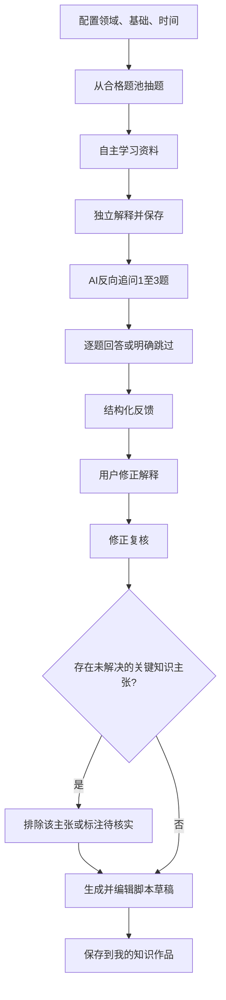
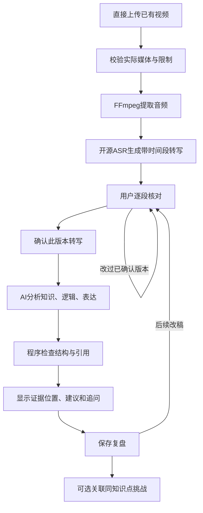

> **2026-10-17 状态更新（优先于下文历史提案）**：用户通过《炼知MVP正式工程任务书V1.0》明确授权本轮 FastAPI + SQLite + 既有原生前端、阻塞修复及最小AI挑战闭环。已实现本地HTTP/SQLite与模型适配，Stub实际HTTP/前端脚本/进程重启测试通过；已用1次真实DeepSeek请求验证服务端闭环与重启读回，浏览器全流程未验收，ASR未实现。用户确认 DeepSeek `deepseek-v4-pro`、`https://api.deepseek.com`、最多3次真实请求；实际累计1次（最多3次；重启不续授权）。旧Streamlit方案是历史提案，本轮以 [ARCHITECTURE](ARCHITECTURE.md) 和 [MVP任务书](MVP_TASK_V1.0.md) 为准。旧PRD未涉本轮的业务边界和DEC状态仍待确认，不推定全部批准。

# 选题罗盘（Knowledge Compass）产品需求文档

| 项目 | 内容 |
| --- | --- |
| 版本与日期 | v0.1，2026-10-13，待用户审核 |
| 文档目的 | 为 AI 编程工具提供明确的产品行为、边界、失败处理和实现约束 |
| 当前交付 | 文档与静态交互 Demo；真实应用尚未实现，整体 PRD 待审核（2026-10-16 事实同步） |
| 目标目录 | `E:\Projects\KnowledgeCompass` |
| 配套文档 | [状态、参数与决策](00-文档约定与决策.md) · [技术方案](02-技术方案与运行安全.md) · [数据协议](03-数据模型与AI协议.md) · [验收](04-验收与测试计划.md) · [开发与演示](05-开发任务与赛事演示.md) |

## 1. 背景、证据与问题定义

> 实现差异说明（2026-10-16）：Demo 已有概率论/C 语言/心理学/哲学四库、Markdown 导入与范例、减速单库抽题及 3/5/10 分钟学习工具计时。当前难度筛选不等于自报基础评测，15/30/60 分钟预算不参与候选过滤；多数题卡无审核来源；AI 与媒体链路仍为 Mock。下文 A1/A2、版本保留与保存要求不因 Demo 行为而自动变更。详见 [基线报告](audits/2026-10-16-项目基线与增量质量检查.md)，待用户批准后再同步业务规则。

### 1.1 背景

大学生希望借助科普视频梳理所学，同时积累能够展示的个人作品。选题、解释知识和检视成片分别需要不同能力：找到合适知识点不等于能解释，生成流畅脚本不等于理解，完成视频也不等于概念正确。

本产品将学习过程留下的解释、追问、修正，与最终作品联系起来，使用户能够回看“我最初怎么理解、哪里被追问、怎样改过、视频又暴露了什么”。以上用户痛点是本项目的产品假设，尚无访谈或实验数据支持，不写成已证明的市场事实。

### 1.2 需求来源和赛事约束

- 产品基线：用户本次提供的定位、两个模式、技术偏好和知识正确性要求，标记为“已确定”。
- 赛事依据：上传的《2026 武汉 1024·人工智能创新生态系列活动——人工智能创新应用黑客松参赛流程指引》，本地文件名 `参赛选手流程指引(3)(1).pdf`，共 5 页。
- 指引第 1–3 页：10 月 20 日前完成报名，10 月 22 日 17:00 前提交作品；时间表属于计划，正式公告优先。
- 指引第 3–4 页：必需材料为代码仓库或可运行 Demo 链接，以及汇报 PPT；演示视频、文档、安装说明和测试数据是可补充材料。
- 指引第 4 页：创新性、技术实现、应用价值、项目完成度、发展潜力是评审维度，未给权重，不自行设定官方分数。
- 官方入口：[赛事官网](https://wuhan.uoyc.com/1024/)。2026-10-13 尝试通过网页工具核对但未能读取，因此没有声称已获得最新正式规则。

建议将“可运行、可解释、可追溯的学习与作品闭环”作为演示主线。赛道暂建议 OPC/个人创新，因其覆盖个人内容生产工作流；最终赛道、具体赛题以及单人参赛/既有原型资格由用户按正式公告确认。

### 1.3 问题与对应设计

| 用户问题 | 产品回应 | 不应作出的承诺 |
| --- | --- | --- |
| 不知道讲什么，选题大小与时间不匹配 | 在经审核的小题库中按基础和预算适配抽题 | 无法准确预测每个人的学习时间 |
| 看懂资料却讲不清概念 | 先独立解释，再用反向追问暴露边界与因果缺口 | AI 不能读出真实理解程度或识别所有照抄 |
| 脚本流畅但知识未必准确 | 反馈分离主张、证据、推断和待核实问题 | 模型自评不是权威事实核查 |
| 成片难以知道具体该改哪里 | 用用户核对稿中的段落和时间位置定位建议 | 音频转写不能替代画面、字幕和剪辑分析 |
| 学习记录与作品散落 | 统一档案保存原解释、修正、脚本、视频复盘与关联 | MVP 不提供公开作品托管或社交传播 |

## 2. 用户、场景与价值

### 2.1 核心用户

核心用户为大学生知识科普创作者：对一个领域有学习意愿，有 15–60 分钟可用于准备，希望拍摄短口播或讲解视频，能自行阅读资料并制作视频。MVP 不以中小学测评、教师评分系统、专业医学法律建议或商业视频批量生产为目标。

### 2.2 关键场景

1. **还没有成片**：课后希望解释“相关不等于因果”，用知识挑战选题、学习、回答追问、修正，再得到可编辑脚本。
2. **已有视频**：带着自己拍摄的 60 秒口播直接进入视频复盘，无须先完成任何挑战；核对转写后获取带位置的改进建议。
3. **同题迭代**：在档案中将某次挑战和之后的视频明确关联，比较当时的解释、修改后的脚本、成片中仍存在的问题。
4. **网络或模型暂不可用**：继续查看题卡、保存解释、核对已生成的转写和浏览旧记录；AI 步骤显示失败/待重试，不能伪造反馈。

### 2.3 核心价值主张

帮助学生把“尝试解释一个知识点”转化为可追溯的学习记录和可继续打磨的科普作品。产品提供解释证据和改进线索，不颁发掌握证明。

## 3. 目标、非目标与衡量方式

### 3.1 MVP 目标

- 两个模式各自能从空档案开始完成闭环，均可保存、关闭后重开查看。
- 每条针对具体视频内容的改进建议可定位到被确认转写稿的实际段落；未核实知识判断有醒目标记。
- 挑战原解释、追问回答和修正记录不可被新版本覆盖，脚本可编辑并导出。
- 用户可以把同一知识点的挑战和视频关联起来，也可以解除关联，不丢失原记录。
- 在演示设备上完成一段 30–90 秒真实样片的本地提音、ASR、核对和 AI 复盘；超时与失败有可复现回退。

### 3.2 验收指标与产品假设验证分离

| 类别 | 建议目标 | 验证方式 |
| --- | --- | --- |
| 工程正确性 | 所有 P0 验收项通过；严重数据丢失、伪核实、越权读取为 0 | [验收矩阵](04-验收与测试计划.md)，真实执行后记录 |
| 证据定位 | 返回的具体问题引用 100% 可解析到当前转写版本/解释原文 | 程序校验 + 人工抽查；不等于建议正确率 100% |
| 学习过程完整性 | 任何“完成挑战”都能找到解释、追问处理、修正复核和脚本版本 | 数据审计，不作为掌握率 |
| 可用性试用 | 建议招募 3–5 名目标用户，观察是否能完成两条路径、是否看懂不确定性标签 | 记录完成时间、卡点、可定位建议的有用性，样本很小，不作教育效果结论 |
| 性能 | 30–90 秒样片的离线转写目标 ≤180 秒；AI 单次目标 ≤60 秒 | 记录硬件、模型、样片长度和冷/热启动实测；未测前不承诺 |

### 3.3 明确不做

MVP 不做自动生成视频、自动剪辑、TTS、数字人、发布到社交平台、热点追踪、粉丝运营、点赞排行、积分打卡、证书或掌握分数、开放领域自动事实核查、网页爬虫、复杂 RAG、向量库、多 Agent 工作流、多租户账号、云端视频存储、后台分布式队列、付费订阅、推荐算法训练。只保留两个核心模式，档案是共享记录区。

## 4. 信息架构与导航

```text
选题罗盘
├─ 首页：两个模式入口、最近记录、当前配置状态
├─ 知识挑战
│  ├─ 配置与抽题
│  ├─ 任务卡与自主学习
│  ├─ 独立解释
│  ├─ 追问与回答
│  ├─ 反馈、修正与复核
│  └─ 脚本编辑与保存
├─ 视频复盘
│  ├─ 上传与可选知识点/已有档案选择
│  ├─ 提音与转写状态
│  ├─ 逐段核对与确认
│  └─ 复盘建议、追问与保存
├─ 我的知识作品
│  ├─ 列表：标题搜索、领域与记录类型筛选
│  └─ 详情：挑战记录、脚本版本、视频、转写版本、复盘、关联、导出/删除
└─ 设置与帮助：本地依赖、API状态、外发说明、数据目录、产品边界
```

“首页”“我的知识作品”“设置”是导航页面，不新增第三种产品模式。独立使用 B 时不弹出“先学习”门槛。用户离开未保存编辑页前显示可见的未保存状态，提供“保存草稿”；P0 不承诺浏览器突然关闭后恢复尚未提交的每次键入。

### 4.1 挑战流程



每个阶段都能保存草稿和退出；失败后回到最近成功阶段。复核失败时不得展示“已修正”；可以保存修正文稿并标记“待复核”，脚本生成暂不可用。

### 4.2 视频复盘流程



任何改稿都产生新版本，旧报告仍可查看但显示“基于旧转写，不代表当前版本”；未再次确认及复盘，不显示新报告已完成。

## 5. 功能清单与优先级

### 5.1 P0：本次 MVP

| 编号 | 功能和最低实现 | 输入 → 输出 | 核心异常/依赖 |
| --- | --- | --- | --- |
| KC-G01 | 两个模式平级入口，可独立开始；共享档案 | 入口选择 → 对应新记录 | 零历史记录也可进入任一模式 |
| KC-G02 | 启动检查、设置页与每类文字外发授权 | 本地配置/用户同意 → 可用状态 | 缺 API 仅禁用 AI；缺 ASR/FFmpeg 仅禁用对应媒体步骤 |
| KC-G03 | 明确保存、记录状态、重复提交保护 | 表单提交 → 持久草稿/结果 | 刷新不重发；失败保留输入；未提交文字不保证持久化 |
| KC-A01 | 领域、基础、预算筛选后抽题与换题 | 配置 → 适配题卡 | 无合格题则提示放宽条件，不编造题库记录 |
| KC-A02 | 目标、前置知识、任务边界、资料链接/节选 | 题卡 → 学习行动 | 失效链接提示；无审核资料题点不进入推荐池 |
| KC-A03 | 用户先独立写解释；保留原文和版本 | 解释 → 保存的独立作答 | 空白拒绝；粘贴内容允许但不认定独立掌握 |
| KC-A04 | 1 轮 1–3 个有针对性问题，回答或跳过 | 独立解释 → 追问/用户回答 | 跳过标记证据缺口；非法 AI 响应可重试 |
| KC-A05 | 三类判断、来源/原文定位、修正与复核 | 解释+回答+资料 → 反馈；修正 → 复核 | 无资料只能待核实；不能自动将模型结论升级为已核实 |
| KC-A06 | 用复核后的材料生成并编辑脚本 | 修正版与未决事项 → 脚本草稿 | 关键未决主张不能写成肯定句；人工编辑后标“未经重新复核” |
| KC-B01 | 本地上传 MP4/MOV/WebM，实测内容校验 | 单视频 → 合法媒体记录 | 过大/过长/伪装/损坏/无音轨明确拒绝对应处理 |
| KC-B02 | FFmpeg 提音，开源 ASR 带时间戳转写 | 媒体 → 段落转写 | 缺依赖、无语音、低质量、超时、内存不足有不同提示 |
| KC-B03 | 保留原稿，逐段修订并确认版本 | ASR段落+修订 → 确认稿 | 未确认不得复盘；确认后修改令既有报告过期 |
| KC-B04 | 针对核对稿分析知识、逻辑、表达 | 确认稿+可用来源 → 结构化复盘 | 来源不足不下知识真伪结论；不分析画面/剪辑 |
| KC-B05 | 段落+时间位置、建议、1–3 条追问，保存 | 复盘结果 → 可定位报告 | 零发现可保存；错引用不能显示为有效建议 |
| KC-W01 | 统一档案列表、标题搜索、类型/领域筛选和详情 | 查询 → 作品及记录 | 无数据/无搜索结果分别提供明确空态 |
| KC-W02 | 用户手工关联同知识点挑战和视频，可解除 | 用户确认 → 关联边 | 不按相似标题自动合并；跨知识点拒绝或要求先修正归属 |
| KC-W03 | Markdown 导出；分别删除媒体/整条记录 | 选择 → 可读文件/删除结果 | 删除前说明范围；导出屏蔽密钥/私密路径；删除失败可重试 |
| KC-Q01 | 判断类型、来源支持状态与学习证据分离 | 主张+来源 → 分层标签 | 无证据禁止“已证实/已经掌握”；冲突来源显式提示 |
| KC-Q02 | JSON schema、引用、版本和不可信输入校验 | AI输出 → 有效结果或错误 | 伪造ID、超出时间、提示注入、过期输出拒收 |
| KC-N01 | 单重任务、进度、超时、清理、中断恢复 | 提交任务 → 可解释状态 | 重启遗留任务标中断，可用已有结果重试 |
| KC-N02 | 本地数据目录、密钥、上传和外发控制 | 配置/文件 → 受限处理 | 路径穿越、命令注入、日志敏感内容必须拦截 |
| KC-D01 | 安装说明、依赖清单、样片、演示与材料 | 已验证构建 → 可复现交付 | 未实际执行的步骤不能写“已验证”；样例与真实结果区分 |

### 5.2 P1：P0 完成且有余量后再审核

| 编号 | 功能 | 范围 |
| --- | --- | --- |
| KC-A07 | 可选文字分镜 | 基于脚本生成镜头表，含台词、画面建议、估计时长；不生成图像/视频 |
| KC-B06 | SRT 导出与人工对齐稿导入 | 人工导入必须有合法时间范围和来源标记；不得伪装为自动转写成功 |
| KC-W04 | JSON 备份与恢复 | 版本兼容、冲突预览和事务恢复，不同步云盘 |
| KC-Q03 | 人工新增资料/来源审核界面 | 手工确认出处、位置、许可与支持关系；不开放自动网页抓取 |

### 5.3 P2：后续产品探索

| 编号 | 功能 | 增加前必须解决 |
| --- | --- | --- |
| KC-A08 | 多轮追问、间隔复习 | 成本、交互疲劳与是否促进学习的验证 |
| KC-B07 | 多模态联合复盘 | 画面/字幕时序证据、模型成本、上传隐私与误判 |
| KC-W05 | 账户、多人和受控分享 | 身份鉴权、对象级授权、隔离、删除权与运营成本 |

## 6. 模式 A 详细交互要求

### A1. 配置和抽题

- 页面控件：领域单选、基础单选、学习预算单选、“抽取知识点”“换一个”。默认值须可见，提交后生成具体题卡。
- 题库字段包括知识点 ID、领域、标题、难度、推荐基础、预估学习分钟、前置知识、学习目标、资料与常见误解。
- 候选集规则：领域一致，基础在支持范围内，`estimated_minutes ≤ time_budget_minutes`，资料审核可用。使用普通伪随机抽取，不需要个性化推荐模型；有多个候选时避免立刻重复。
- 无候选时给出“增大学习预算/调整基础/更换领域”，不调用模型临时造题。有一个候选时提示只找到一个。
- 未开始解释时可换题；已有已提交解释再换题必须新建挑战，旧草稿保留。

### A2. 自主学习

- 卡片展示“本次要能解释什么”“可以不展开什么”“预计用时”“资料出处和具体位置”。用时只是建议。
- 允许打开链接查看原文；本地审核片段保证来源站点暂不可访问时仍能知道依据。
- 用户点“我已学习，开始解释”仅记录自报动作，不记录“掌握=true”。P0 不监控停留时间、学习行为或录屏。
- 生成式答案和完整脚本在独立解释提交前不可提前显示；题卡可包含基本概念与学习资料，但不代写用户回答。

### A3. 独立解释

- 文本提示：“请用自己的话向同学解释这个知识点，可以举例并说明适用边界。”
- 输入为去空白后 1–6000 字符；低于 50 字给补充提示但不拦截；空白拒绝并定位字段，超过上限保留编辑内容供精简。
- 首次提交保存不可变原解释和提交时间。再次修改生成新版本，基于旧版本的追问/反馈显示过期；不得用新原文与旧结果混排。

### A4. 反向追问

- AI 输入：题卡、人工审核来源、原解释版本；将用户内容作为数据隔离，不执行其中指令。
- 输出：1–3 题，覆盖原因/边界/迁移中适用的维度，每题包含问题 ID、追问依据、对应解释片段和考察意图；不能在题干直接给完整答案。
- 用户逐题填写 1–2000 字符回答，或点“暂时不会/跳过”；所有题有回答或跳过状态后才进入反馈。
- 模型认为信息很少时也应提出澄清问题，不能用“完全正确，无需追问”跳过整个环节。生成失败则保留原解释并允许重试，不伪造个性化问题。

### A5. 反馈、修正、修正复核

- 首轮反馈输入为原解释、回答/跳过、题卡和来源；输出包括可取之处、问题项、来源支持情况、改进建议、仍需核实的内容和下一步。
- 每项问题须可追溯到用户解释/回答的引用位置，或显式标明这是“缺少对某概念的解释”，不能捏造用户说过的话。
- 用户在修正区写出 1–6000 字符解释；初始区为空或由用户主动复制自己的原文，不默认填入模型答案并宣称是用户修正。
- “提交修正并复核”产生新修正版本；AI 复核指出原问题中哪些在表达上得到处理、哪些仍未解决。即使说法改善，也不代表知识被权威证实。
- 一轮交互即可进入脚本；不以反复“刷到全对”作为流程要求。保留未解决事项，不设置及格线。复核失败仅保存修正，提示稍后重试。

### A6. 脚本与保存

- 输入：最新完成复核的修正版本、可支持的来源信息、未决主张清单、目标时长。
- 输出 Markdown 至少包括标题、开场、核心解释、例子、边界/误区、结尾、参考来源和待核实备注；估计 60–120 秒，注明实际口播时长因人而异。
- 核心仍不确定时，应省略该结论或写入待核实说明；不能用流畅表述掩盖不确定性。如果排除后已无法形成合理脚本，返回“需补充依据”，允许保存草稿。
- 脚本以“AI 辅助草稿”呈现，用户可编辑并保存新版本。人工编辑内容不会自动继承先前复核状态，展示“此脚本编辑尚未重新复核”。P0 不再增加自动脚本复核工作流。
- “保存挑战记录”保存当前阶段；只有解释、追问处理、反馈、修正复核、脚本均存在才标“流程完成”。页面始终不显示“知识已掌握”。
- 可选分镜为 P1；P0 界面不放不可用占位按钮。

### A7. 异常与空态

| 情况 | 行为 |
| --- | --- |
| 无题库/无审核资料 | 显示未配置说明，阻止抽题；仍能浏览历史作品 |
| API 未配置/未授权外发 | 允许学习、保存解释，AI 按钮显示所缺条件 |
| 模型超时、限流、网络异常 | 最多 1 次额外自动重试；继续失败显示原因与手动重试；输入不丢失 |
| 非 JSON/引用无效/伪造来源 | 不落为成功反馈；在同一额外尝试预算内修复，仍失败则停止 |
| 用户全跳过追问 | 能保存并获得有限反馈，但展示“回答证据不足”；不能推断已理解 |
| 只有修正未复核 | 保存“待复核”草稿；不开放 AI 脚本生成 |
| 无明显问题 | 展示覆盖范围、现有依据和仍可探究的边界，不强造错误 |

## 7. 模式 B 详细交互要求

### B1. 上传和归属

- 任意用户可直接上传一个文件；可选填写标题、选择题库知识点或已有作品档案。无匹配题时允许“暂未分类”，不是失败。
- 独立视频先拥有自己的档案/复盘记录，之后再手工关联；模型不能凭标题自动合并记录。
- 显示限制：100 MiB、5 分钟、MP4/MOV/WebM，面向普通话口播。使用 ffprobe 检查实际容器、时长及音轨，不能只检查后缀。
- 原文件名仅作展示，实际文件用应用生成 ID 存储。0 字节、损坏、不可解码、无音轨或不符合限制的文件给出不同错误，不能继续生成假转写。
- 多音轨按默认音轨优先，否则第一个音轨；明确展示选择，不保证自动识别最佳讲话音轨。手工多音轨切换不列入 P0。

### B2. 提音和转写

- 用户点“开始转写”才执行；显示校验、提音、转写、待核对四个阶段，不伪造精确剩余时间或百分比。
- 音频由 FFmpeg 解码为单声道 16 kHz PCM WAV，保留对应原视频播放时间位置；若时间轴异常且无法可靠归一化，则报错，不将错位时间当证据。
- 使用本地开源 ASR，保存模型 ID、运行参数、时间、音轨和分段文本。时间戳用毫秒整数，UI 转成 `mm:ss`；这是识别器估计的片段范围，不是逐词精确对齐。
- 空语音/纯音乐/严重噪声分别展示未识别到可用语音或质量提示；转写质量分数如存在仅作提示，不代表知识正确性，不杜撰准确率。
- 提取或识别失败后可重试当前阶段、重新上传、保存失败记录或退出；MVP 不要求靠手工粘贴整篇文字冒充视频复盘成功。人工带时间导入列 P1。

### B3. 核对转写

- 转写页每段展示稳定的段 ID、起止时间、识别原文、可编辑文字与播放定位入口。
- 段落文字可以置空以删除误识别噪声，但至少一段有效文字；全稿去空白后不超过 12000 字符，避免超出 AI 上下文预算。超限提示精简或上传更短视频，不静默截断。
- ASR 原始文本不可改写覆盖；用户编辑形成新修订，保存草稿不会视作核对完成。
- 用户必须主动点“我已核对，确认此稿”。说明确认的是转写与自己的音频基本一致，不是其中知识事实已经核实。
- P0 只编辑文字，不支持时间边界修改、拆段/合段。时间明显偏移可重新转写/上传更清晰音轨；无法可靠对齐则拒绝位置型复盘。
- 已确认稿若再次修改，保存为新的未确认版本，旧报告标过期；再次确认并点击复盘后产生新报告，旧报告不覆盖。

### B4. AI 复盘

- 输入：确认稿及版本、段 ID 和起止毫秒、可选关联知识点的审核来源包；不发送原视频/音频。
- 输出三个维度：知识主张和证据缺口、逻辑连接和边界、文本表达和术语使用。表达仅指文字层面，不评价音色、情绪、语速、肢体或剪辑。
- 每项具体发现包括维度、严重性、判断类型、原句引用、段 ID/时间、原因、可执行修改、证据来源和需进一步核实事项。
- 严重性是修改优先级（高/中/低），不是知识真假置信度或考试分数。
- 对文字中可验证的事实性主张，只有来源包确实提供了相应支持关系，才显示“有已审核来源支持”；其他显示“待核实”。对来源冲突/上下文不足须保留冲突，不能用多个模型投票代替核查。
- 没有发现时返回空发现数组与覆盖说明，不强行生成固定数量错误。追问为 1–3 条或在信息不足时返回澄清问题，不能以“无错误”暗示掌握。

### B5. 定位、追问和保存

- 点击建议定位对应片段，展示引用文字和时间范围，并尝试从片段起点播放本地视频。浏览器不支持该格式播放时保留时间和引用，提示用本地播放器查看；不让“浏览器能播放”成为 ASR 成功条件。
- 对整体逻辑的判断可引用多个片段；对缺失内容显式写“稿件中未体现”，不得虚构对应时间点。
- 用户可以标记建议“准备修改/暂不采纳”，也可记录复盘追问的个人回答；P0 该记录不再自动引入一轮 AI 评分，避免多轮膨胀。
- 保存后档案显示视频、确认稿版本、有效报告、来源范围与未决问题。保存成片本身只表示作品记录存在。

### B6. 异常与回退

| 情况 | 处理方式 |
| --- | --- |
| 无上传文件 | 说明支持范围，展示上传控件，不触发任务 |
| 超限/损坏/无音轨 | 在对应检查阶段终止并给修复建议；临时文件清理 |
| 模型文件未准备/下载失败 | 显示本地 ASR 不可用；引导准备依赖后重试，不能偷偷换云 ASR |
| 无语音或全空转写 | 不进入确认/复盘，建议检查音轨或上传清晰短片 |
| 大量错词 | 提醒先校对；用户确认后才分析；不能保证 ASR 正确 |
| ASR 超时/内存不足 | 终止进程并释放资源，保留可用上传文件，允许改短片重试 |
| AI 输出时间超出视频/引用不存在 | 判无效输出；不向用户展示无依据的定位建议 |
| AI 故障 | 核对稿可保存/导出，稍后重试，不把离线示例显示成这次实际结果 |
| 删掉本地视频 | 报告和引用仍可查看，播放显示“媒体已删除”；不要删除学习文字记录 |

## 8. 共享档案与业务规则

### 8.1 对象关系

一个知识点可有多个作品档案；一个档案聚合多次挑战、多个视频复盘；挑战与视频复盘均能独立存在。挑战必须来自题库知识点，独立视频允许未分类。具体主键、字段和版本关系见 [数据协议](03-数据模型与AI协议.md)。

关联是用户确认的显式关系，P0 一个视频复盘最多关联一次挑战，一次挑战可关联多个视频。同意关联后，仅将选中复盘归入该挑战所在档案，保留原内容和操作记录，不移动原档案的其他记录。解除关联只清空挑战关联，复盘仍留在当前档案；空档案可由用户另行删除。已有明确知识点不一致时禁止关联；未分类视频须由用户先确认归属到目标知识点。关联界面展示标题、时间和知识点，避免同名误选。

### 8.2 列表、搜索与空态

- 列表显示标题、领域/未分类、最近更新时间、挑战/视频数量、流程状态和未决事项数量；不展示“掌握率”。
- 标题关键词、领域、记录类型筛选即可，不开发语义搜索。
- 零档案时同时展示“开始知识挑战”和“上传视频复盘”；有档案但筛选无结果时提供清空筛选。
- 详情按创建时间呈现历史版本，默认打开最新有效结果；过期结果加可见标记。

### 8.3 保存、导出、删除

- 每个阶段提交即持久化；用户手动保存草稿，页面回退/刷新不自动重跑 AI 或 ASR。
- 导出 Markdown 包含原解释、修正、脚本、时间定位、来源、判断标签与未决问题；注明生成时间、协议版本和报告对应的转写版本。
- “删除媒体”只清理本应用保存的视频及衍生音频，保留文字报告并记录媒体已删除。
- “删除记录/档案”展示将删除的对象、链接和媒体范围，用户确认后删除应用目录中的相关内容；共享引用或其他记录不能误删。失败时记录删除待完成状态，重试可安全重复。
- 导出到应用外部的文件由用户自行管理，应用不能声称已撤回；原始上传文件若在外部目录中，应用不得删除。

## 9. 知识正确性与不确定性约束

### 9.1 两条正交维度

| 维度 | 值 | 展示含义 |
| --- | --- | --- |
| 判断类型 | 可验证事实 / 合理推断 / 待核实判断 | 这是何种主张，是否能凭现有材料下结论 |
| 证据状态 | 有审核来源支持 / 与来源冲突 / 来源不足 / 不适用 | 有何依据，不等于世界范围内的最终真理 |

“可验证事实”表示客观可查证，不能自动理解为“本系统已经验证”。模型输出的所有正确性评价默认属于模型辅助意见。来源曾被人工阅读不等于它支持任何模型新结论；只有审核来源中已明确绑定的事实主张才有资格显示支持标签，其他关联保持待核实。

### 9.2 强制规则

1. 原文定位证据与外部知识证据分开。证明“用户说过这句话”不能证明“这句话是真的”。
2. 无来源不得编造书名、网址、论文或页码；模型返回不存在的来源 ID 整项无效。
3. 推断必须列出依据、适用条件和局限；不确定用“可能/需要核对”，不以高置信度数值替代依据。
4. 冲突资料保留双方出处、具体分歧和需要人工核查的动作。知识库本身有争议的题卡不得作为唯一正确答案。
5. 无来源材料的视频仍可获得文本逻辑与表达建议，知识部分只能列出待核实主张和核查路径。
6. 不评价画面上看不到的事实，不从语音文本推断身份、情绪、能力或学习动机。
7. 生成脚本不得将未决主张洗成确定叙述。合适的处理是删去、限定条件或明确标注待核实。
8. 独立解释是用户提交的过程记录，不具有防作弊能力；不声称检测出照抄或证明长期掌握。
9. 不生成专业诊断、法律结论或金融决策建议；首批题库避开高风险具体决策主题。
10. 所有 AI 内容可被用户质疑；用户异议仅记录异议，不能自动反向更改来源事实。

## 10. 非功能要求与安全边界

- 单机单用户为建议基线；不以“有一个密码”替代公网安全设计。若需公网演示，须重新确认部署和隐私范围。
- 不在浏览器、仓库、日志或导出中暴露 API 密钥；原视频和音频本地处理；向 API 外发文字前说明对象和用途。
- 模型响应、转写和外部资料是数据，不能控制文件路径、执行命令、读取环境变量或调用额外工具。
- 文件大小在上传接收层及落盘后分别检查；媒体解码通过参数数组、受限目录及超时；详细实现见技术方案。
- 运行时限制一个重任务；正常任务有状态，异常任务能中断、清理并重试。不能因为 Streamlit 页面重新渲染再次扣费。
- 保存耗时目标 ≤1 秒（小型本地记录、非媒体转写）；性能数字均为验收目标，实际设备必须测试。
- 错误提示用中文描述“哪个阶段失败、数据是否保存、下一步是什么”，不向用户抛整页内部堆栈。

## 11. 范围矛盾、风险与取舍

| 矛盾/风险 | 本版处理 | 剩余问题 |
| --- | --- | --- |
| 公开作品资产 vs 本地 MVP | 提供可导出的记录和脚本，可外部发布；不自建公开社区 | 用户若必须公开作品页，需要重新估算 |
| 知识准确性分析 vs 无联网核查 | 小型审核来源包 + 待核实清单 | 无来源情况下不能给真假结论 |
| 时间有限 vs 两个完整模式 | 两条闭环保留；缩小领域、视频长度和追问轮数 | 不允许删掉 B 后仍称完成既定 MVP |
| 视频复盘 vs 纯音频技术路线 | 清楚标注“基于核对稿的内容复盘” | 视觉错误与字幕错误无法发现 |
| 自动追问 vs 独立思考 | 先保存用户解释，再给问题，再反馈 | 无法证明回答由用户独立完成 |
| 来源审核成本 vs 题库规模 | 建议 12 题，审核不完可以正式缩减 | 不允许未审核题卡充数 |
| 单机性能/模型下载 | D0 先测真实短片；CPU 优先，GPU 可选 | 未确认硬件与网络，不承诺 ASR 时间 |
| API 成本和隐私 | 控制输入长度、轮次、重试，确认服务商与预算 | 当前没有价格、预算或数据保留承诺 |
| 文档完备 vs 开发工期 | 文档定义 P1/P2，但任务执行仅 P0 | AI 编程工具不得把所有候选一口气实现 |

## 12. 开发准入和需求变更

本套文档完成后停在审核阶段。用户确认 DEC-01、运行场景、首批领域、媒体边界及留存方式后，才能启动实现；API 集成还需确定服务与可用配置。任何时间表都是审批后的计划，不是自动授权。

对 AI 编程工具的约束：每次只处理一个已排定任务，说明关联需求 ID、改动范围、异常行为及验证方法；遇到跨文档冲突先列明冲突并修正文档，不自行扩大 P0。完成状态由验收证据决定，不由“页面看起来完成”决定。

验收标准、测试数据、任务依赖、赛事提交清单、三分钟演示和具体待确认清单分别见配套文档。本版不声称任何应用功能已实现或任何产品测试已通过。
