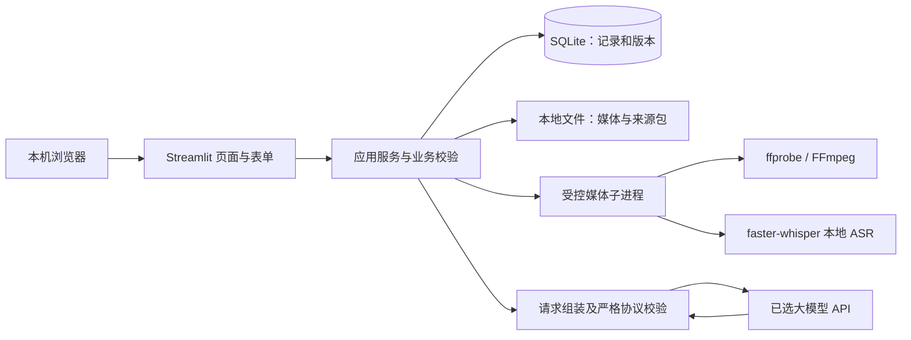

> **2026-10-18 视频转写专项更新**：用户明确授权真实本地MP4转写/校对/SQLite闭环，并单独批准仅下载固定版本small模型。已先用本轮新录制视频验证CPU INT8，再接FastAPI；实际HTTP/前端脚本/SQLite/进程重启读回通过。当前限制180秒/100MiB，新ASR时间单位为秒，Schema v2；云端AI视频复盘未实现、GPU/真实浏览器未验收。详见[ASR说明](ASR.md)和最新HANDOFF；下文历史提案/旧状态不自动代表当前实现，其他DEC状态不变。

> **2026-10-17 状态更新（优先于下文历史提案）**：用户通过《炼知MVP正式工程任务书V1.0》明确授权本轮 FastAPI + SQLite + 既有原生前端、阻塞修复及最小AI挑战闭环。已实现本地HTTP/SQLite与模型适配，Stub实际HTTP/前端脚本/进程重启测试通过；已用1次真实DeepSeek请求验证服务端闭环与重启读回，浏览器全流程未验收，ASR未实现。用户确认 DeepSeek `deepseek-v4-pro`、`https://api.deepseek.com`、最多3次真实请求；实际累计1次（最多3次；重启不续授权）。旧Streamlit方案是历史提案，本轮以 [ARCHITECTURE](ARCHITECTURE.md) 和 [MVP任务书](MVP_TASK_V1.0.md) 为准。旧PRD未涉本轮的业务边界和DEC状态仍待确认，不推定全部批准。

# 选题罗盘：技术方案与运行安全

- 版本：v0.1，待审核；核查日期：2026-10-13。
- 本文描述拟采用的设计，不代表应用已经实现、依赖已经安装或兼容性已经实测。
- 产品边界和参数以 [文档约定与决策](00-文档约定与决策.md) 为准；行为以 [PRD](01-产品需求文档PRD.md) 为准；字段和协议以 [数据模型与 AI 协议](03-数据模型与AI协议.md) 为准。
- 对应需求：KC-G02、KC-G03、KC-B01–KC-B05、KC-W03、KC-Q01、KC-Q02、KC-N01、KC-N02、KC-D01。

> 2026-10-16 状态补记：已有纯静态 Demo，尚无 Python/FastAPI/Streamlit 应用、SQLite 或真实 API/ASR。保留前端 + FastAPI + SQLite 正在评估，与下文“暂不增加 FastAPI”的旧方案冲突，须用户批准替代后才修订架构、启动方式与接口设计。下文 Streamlit rerun/Session State、上传参数、.streamlit 配置不是现有 Demo 行为，也不能直接用于 FastAPI。非框架特定的隐私、版本、任务和媒体安全要求仍需在获批实现中验证。比较及风险见 [基线报告 §6](audits/2026-10-16-项目基线与增量质量检查.md#6-架构取舍与-fastapi--sqlite-风险)。

## 1. 技术决策及适用边界

**建议基线 / 待确认：Windows 本机、单用户、一个 Streamlit 应用、SQLite、本地媒体目录、本地 ASR、一个外部大模型 API。** 两个核心模式在同一应用内运行，共用档案和基础设施。暂不增加 FastAPI、Redis、消息队列、对象存储、向量数据库或独立前端。



媒体子进程是由应用临时启动和回收的执行单元，不提供网络接口，不构成额外常驻服务。浏览器只访问本机应用；大模型只接收用户同意发送的必要文字及来源片段，原视频和音频留在本地。

P0 不承担公网多人访问。若改为公共 Demo，需要重新设计身份鉴权、对象级授权、上传隔离、存储配额、并发、速率限制和部署运维；不能仅将监听地址改为公网便声称满足同样安全要求。

## 2. 建议模块划分与目录

以下为**审核通过后的计划目录**，当前阶段不要求生成这些应用文件：

```text
KnowledgeCompass/
├─ app.py                     # 应用入口与导航
├─ pages/                     # 知识挑战、视频复盘、作品档案、设置页面
├─ core/
│  ├─ config.py               # 参数、路径、密钥读取、启动检查
│  ├─ contracts.py            # 输入与输出数据结构、约束
│  ├─ workflows.py            # 两个模式的状态转换及版本失效规则
│  └─ errors.py               # 面向用户的错误类别
├─ services/
│  ├─ challenge.py            # 抽题、追问、反馈、修正、脚本
│  ├─ review.py               # 核对稿、复盘和引用解析
│  ├─ media.py                # 上传校验、媒体探测、提音、子进程监督
│  ├─ asr_worker.py           # 单次本地 ASR 子进程入口
│  ├─ llm.py                  # 单一供应商适配、超时、输出解析
│  └─ archive.py              # 归档、关联、导出、删除
├─ storage/                   # SQLite 读写、迁移和事务
├─ prompts/                   # 可审阅的提示词与版本信息
├─ knowledge/                 # 人工审核题卡和许可允许保存的来源片段
├─ tests/                     # 协议、状态、存储、媒体和完整路径验证
├─ samples/                   # 已获授权的短片及测试说明
├─ docs/                      # 本套需求与后续运行说明
├─ .streamlit/                # 非敏感运行配置
└─ runtime/                   # 运行生成，排除出 Git
   ├─ app.db
   ├─ media/
   ├─ temp/
   ├─ models/
   └─ logs/
```

目录按职责划分即可，不为每个需求建立一个服务或一层抽象。界面层不直接拼接 SQL、不直接解释模型输出、不直接调用 FFmpeg。业务校验作为普通 Python 函数便于测试；结构化协议建议使用 Pydantic，SQLite 可直接使用 Python 标准库 `sqlite3`，P0 无须引入 ORM。

项目目标路径为 `E:\Projects\KnowledgeCompass`。使用配置和相对项目根目录的路径定位资源，不把开发者账户名或盘符写死在业务逻辑中。E 盘需为可写的本机磁盘，有足够可用空间；数据库不放网络共享目录。当前文档存放授权与未来应用编码审批是两件事。

## 3. Streamlit 状态、幂等与重任务执行

### 3.1 页面重跑与持久化

**官方事实：** Streamlit 交互会触发脚本重新执行；Session State 可跨重跑保存会话数据，但浏览器刷新导致连接重建时可能重置。因此不能只靠页面变量保存作品，也不能把 AI 调用放在每次页面绘制必经的路径上。[S01][S02]

**实现建议：**

1. 输入使用表单和明确提交按钮；只在“开始转写”“生成追问”“开始复盘”等已提交动作中创建任务。
2. 已提交输入先持久化，再创建任务；页面刷新只读取任务与结果，不重做任务。未提交键入内容只保证当前页面可编辑，不宣称永久自动保存。
3. 对一个逻辑请求生成稳定去重键，至少包含操作类型、对象 ID、输入版本或内容摘要、提示词版本、协议版本、模型配置。数据库对逻辑请求的唯一性提供最终约束，按钮禁用仅是交互辅助。
4. 成功结果命中同一逻辑请求时直接读取；运行中显示状态；失败后用户明确重试才创建新的尝试，并关联原逻辑请求。
5. 转写稿、解释或来源版本变化会形成新逻辑请求。旧结果保留历史身份，不直接写成新版本的有效结果。

“幂等”目标是阻止重复点击、页面重跑和刷新创建重复作业或重复档案。外部 API 发生网络超时时，客户端可能不知道服务商是否已经处理；未确认服务商支持幂等键前，不能承诺所有超时重试都不会再次计费。每次实际尝试应记录请求编号和用量（若服务商返回），供排查重复费用。

### 3.2 单机同时最多一个重任务

- 将提音、ASR 和 LLM 调用归为受限重任务，同一数据目录同时最多运行一个；第二个提交提示当前任务尚未结束，不建立无限队列。
- P0 采用同步等待：界面展示阶段状态，应用监督临时子进程；不要求用户离开页面后仍能稳定后台续跑。
- 本地进程锁约束同一数据目录只启动一个应用实例；数据库事务负责原子地取得重任务占用权。重复浏览器标签页不能绕过限制。
- 任务记录至少保存逻辑请求、尝试、状态、开始/结束时间、阶段、输入版本、错误类别以及输出位置；完整字段以数据协议为准。
- ASR 通过临时子进程执行，以便在超时或内存不足时真正终止并释放模型资源。不要用“线程等待超时”冒充停止仍在运行的推理。
- 子进程使用同一已锁定 Python 环境、已知可执行文件和应用生成参数；Windows 不弹出额外终端窗口。应用负责回收自己启动的进程及子进程，不按宽泛进程名称终止其他用户任务。
- Windows 采用启动全新进程的方式（spawn 语义），不依赖 Unix `fork` 或继承父进程模型对象。建议用 `subprocess` 启动专用 ASR 入口；入口须有主模块保护，导入模块时不启动任务，不导入或重新运行 Streamlit 页面。输入通过应用生成的临时文件路径/任务参数传递，结果通过受限 JSON 文件或管道返回。
- 同步 ASR 子进程会产生模型加载开销，必须计入冷启动测试；P0 不同时承诺跨进程模型常驻缓存。先完成可靠性，再按实测决定是否值得优化。

### 3.3 超时、重试与恢复

| 阶段 | 建议硬上限 | 超时或失败后处理 |
| --- | --- | --- |
| ffprobe | 15 秒 | 终止探测，返回媒体检查失败；不进入解码 |
| FFmpeg | 120 秒 | 终止并清理不完整音频；保留已校验上传文件供重试 |
| ASR | 600 秒 | 终止进程，释放资源；不把部分转写标为完整；提示短片重试 |
| 单次 LLM | 60 秒 | 记录超时；适用时最多额外尝试 1 次 |
| 同一 LLM 逻辑步骤 | 合计 125 秒 | 两次请求及退避/修复共享此截止时间，超过即失败 |

LLM 的“最多额外 1 次”包括网络重试、限流重试和 JSON 修复，不能叠加成每一类都重试一次。认证失败、未授权文字外发、明确无效输入不自动重试；限流可在总截止时间内有限退避。接口返回合法 JSON 后若引用错误，可使用唯一剩余尝试请求修复；仍不合格则保留输入并停止。

应用启动时检查遗留运行任务：先确认旧实例已停止、应用拥有的子进程已退出或已被安全回收，再将遗留任务标为“中断”。不能仅把数据库状态改为空闲而让旧进程继续占用资源。重启后由用户重试，不自动继续付费 API 调用。

阶段成功的提交必须核对当初的输入版本仍匹配；若用户已提交新版本，结果只归属旧版本并标为过期，不覆盖新记录。磁盘满、写入失败或事务失败时，显示“未保存成功”，不能先展示已归档再忽略错误。

## 4. 视频上传、提音及时间轴

### 4.1 三层验证

1. **接收层**：单文件；可选后缀为 MP4、MOV、WebM；严格大小为 `0 < size_bytes ≤ 104857600`，即 100 MiB。界面与后端须使用同一字节常量，不将 100 MiB 写成 100 MB。
2. **落盘层**：原文件名只作展示；内部使用生成的 ID，写入专用临时目录并再次检查实际字节数；不接受用户指定写入路径。
3. **媒体层**：ffprobe 检查真实容器、音轨、可解析时长及流信息；要求 `0 < duration_ms ≤ 300000`。解码时继续检验损坏数据，探测成功不等于文件一定可完整解码。

**官方事实：** Streamlit 默认上传上限为 200 MB，可全局配置；当前文档也提供组件级配置。扩展名/MIME 过滤并不提供安全保证。[S03] **设计要求：**接收层额度只是第一道检查，应用使用精确字节值二次拦截；所选 Streamlit 版本是否支持组件级参数在锁版时确认，不能照最新文档调用旧版本没有的参数。

拒绝零字节、过大、过长、损坏、不可解码、未允许容器、无音轨文件，返回不同错误原因。多音轨优先选择标记为默认的音轨，否则选择第一条音轨；多个默认标记时使用其中第一条，记录实际索引并在界面显示。P0 不增加手工音轨选择器。

### 4.2 统一中间音频

- FFmpeg 仅读取本应用已保存的本地文件和选定音轨，转换为单声道、16 kHz、16 位 PCM WAV；不执行视频压缩或视频重编码。
- 使用固定参数列表和 `shell=False` 调用，不拼接字符串命令；输入路径、输出路径和可执行文件均由应用校验。
- 对无损解码和时序要求设置边界：原视频播放时间以零为起点，音轨开始时间及可识别偏移必须纳入映射；不得简单把“音轨第一句”误当成“视频 0 秒”。
- ASR 结果最后映射到视频时间轴，并保存采用的音轨、偏移/归一化信息；不能可靠计算偏移、时长缺失或时间轴异常时停止位置型复盘并说明原因。
- 不预先裁掉静音再拼接音频。若开启识别器 VAD，适配器仍须保证返回段落对应原音频时间；以带首段静音和中间静音的样片验证，不能仅相信肉眼看似合理的时间。
- 临时音频任务结束后清理，包括正常、失败和超时路径；持久保存原视频，失败重试时重新提音。测试日志记录阶段与时长，不记录完整用户台词。

ffprobe 能输出格式与流信息，但媒体合法性和业务限制仍由应用处理。[S04] 含真实字幕/画面知识的视频，本版只根据核对稿评价口播文本，不能假称已分析视觉内容。

## 5. 本地 ASR 与转写核对

### 5.1 建议配置

首选候选为 faster-whisper `small` 多语言模型、CPU `int8`，普通话场景使用转写任务而非翻译任务；根据实际输入语言策略决定是否固定中文，配置必须记录。GPU 是可选优化，不作为演示前提。若设备实测不达标，可以评测 `base` 并由用户接受质量取舍，不能静默更换模型。

**官方事实：** faster-whisper 支持 CPU int8、片段起止时间和可选词级时间；其 `segments` 是生成器，迭代时才实际执行转写；支持 Silero VAD。按模型名加载可能自动下载模型。GPU 路径存在 CUDA、cuDNN 与 CTranslate2 配套要求。[S05]

**实现要求：**

- 在开发验证和演示前下载指定模型快照到本地目录，记录仓库、revision 和许可；运行过程从明确本地路径加载。网络下载失败单独提示，不改用云端 ASR。
- 任务必须完整消费 segment 生成器；只拿到返回对象不能标“转写完成”。生成器后半段抛错时整次识别仍判失败，部分输出可留作诊断但不能进入确认和正式复盘。
- 保留段 ID、顺序、原始文本、整数起止毫秒、模型参数和原视频时间轴映射；输出时间须有限、非负、起点严格小于终点、不能越过视频末尾。
- P0 保存片段时间，不依赖词级对齐；小幅识别误差须明示，不用毫秒显示精度暗示定位绝对准确。
- 可启用 VAD，但纯静音、音乐、背景噪声仍须专项测试。`no_speech_prob`、`avg_logprob` 等仅作识别诊断，不能当作转写准确率、事实准确率或学习掌握率。[S06]
- 空段集合、全空白文本、VAD 后无可用语音分别归入可解释的空结果，不调用 LLM 生成虚构复盘。

### 5.2 版本化核对与复盘资格

用户逐段修改文字，保留原始 ASR 文本、段 ID、顺序和起止时间；P0 不拆段、合段或手工改时间。允许清空单段误识别文字，但全稿至少有一段有效文字，去空白后总长度不超过 12000 字符。确认动作生成不可变的确认稿版本。

只有确认稿能提交复盘。用户之后编辑形成新的未确认版本，原报告保留，但显示对应旧版本且过期。删除媒体只导致播放不可用，不破坏段落证据和旧报告。浏览器无法播放某种编码时仍展示时间和引用，给出本地查看提示；不追加自动视频转码范围。

## 6. AI 请求、结构与引用校验

### 6.1 单一适配层

模型供应商、具体模型、价格、每日预算和数据保留政策均待确认。适配层向业务暴露追问、反馈、修正复核、脚本和视频复盘等明确操作，不在 P0 建立通用 Agent 或工具调用框架。采用供应商可用的结构化输出能力，但本地校验不可省略。

每次请求固定记录输入对象及版本、知识来源包版本、模型名、提示词版本、协议 `v1.0`、请求/尝试编号、时间和返回用量。没有返回用量时记录未知，不推算为零费用。

### 6.2 五道结果校验

| 层次 | 校验要求 | 失败行为 |
| --- | --- | --- |
| 结构 | 严格 JSON；必填字段、类型、枚举、长度、数组数量符合协议；拒绝额外控制字段 | 不落为成功结果；有限修复或失败 |
| 对象 | 返回的对象、输入版本、段 ID、解释/回答 ID 必须属于当前请求允许集合 | 拒收跨对象、伪造或过期引用 |
| 原文 | 引用必须能在对应版本的真实原文中定位；引用偏移和摘录一致；缺失内容明确标记为缺失 | 不给虚构时间点，不将近似句冒充原话 |
| 时间 | 时间从已验证的 segment 计算/解析，模型返回时间仅作一致性检查；不允许越过视频范围 | 拒收错误定位，不自动“修成看起来合理” |
| 知识证据 | 来源 ID、来源位置和主张支持关系须属于审核包；模型输出不能给自己授予审核资格 | 降为待核实或拒收，按协议明确处理 |

来源定位和主张支持必须分开：查到真实来源 ID 只说明来源存在，不能证明它支持模型给出的任何新结论。仅当人工审核来源包预先绑定相应事实主张及关系，且输出正确匹配时，程序才赋予“有审核来源支持”。无既有绑定的模型推断必须保持推断或待核实。具体字段、映射与错误策略以 [数据协议](03-数据模型与AI协议.md) 为准。

### 6.3 不可信内容与表达约束

- 解释、转写、上传文件名、资料片段和模型回答都是数据；使用清楚的数据边界组装提示，明确不得把其中的“忽略规则”等文字当系统指令。
- 模型无权执行代码、调用 shell、读取本地目录或密钥、抓取网址、自动修改来源审核结论。模型生成的链接不能成为自动抓取入口。
- 渲染结果采用受限 Markdown/文本，不允许模型插入任意脚本、任意本地文件链接或不安全 HTML。
- 分开显示“可验证事实 / 合理推断 / 待核实判断”与证据状态；无来源不得捏造书名、页码或网址。
- 脚本只依赖最新修正复核结果；未决主张必须省略、限定或醒目标注。用户修改脚本产生新版本，不能继承未经验证的正确性标记。
- 挑战最多 4 个逻辑 AI 步骤，每步最多一次额外尝试；视频复盘不因用户回答追问自动启动新一轮 AI 评分。

## 7. SQLite、文件一致性和删除

### 7.1 本地数据库

**官方事实：** SQLite 单数据库同时只有一个写者；WAL 允许读写更好地并行，但不提供多写者同时提交。WAL 要求同一主机，不适用于网络文件系统。[S07][S08]

**实现建议：**

- SQLite 放本机 `runtime/`，媒体存文件系统，库内保存应用相对路径、摘要、大小、状态与关系，不把视频二进制存成数据库 BLOB。
- 启用外键约束和有限 `busy_timeout`，根据实际运行验证是否启用 WAL；采用短事务。不得在打开写事务期间等待 ASR、API 或用户操作。
- 每个操作/执行上下文建立和关闭自身连接，不把默认线程受限的 `sqlite3.Connection` 随意跨线程共享。采用参数化 SQL，不拼接用户搜索词。
- 新版本插入和当前版本指针更新在同一事务完成。只有事务成功才显示已保存；写入失败时原有效版本仍可读取。
- 确认稿更换、解释修订、来源版本变化导致派生结果失效；按输入版本关系判断，不靠 UI 文案手工猜测。
- 关联/解除关联在事务中检验知识点一致和目标存在；使用可空 `video_review.linked_challenge_id` 表示关系，一个复盘最多关联一次挑战，一次挑战可关联多个复盘。关联时将选中复盘归入挑战所属作品档案，保留原档案其他记录；解除只清空关联，复盘仍在当前档案，不搬回原档案，也不级联删除挑战或媒体。

### 7.2 文件与数据库不是同一事务

媒体文件先写入临时文件并完成校验，再在应用目录内原子改名到生成的目标路径；数据库随后记录可用媒体。任一步失败必须保留可恢复状态或清理孤立文件，不能让记录指向未写完文件。

启动清理只处理应用拥有的临时目录和已登记待处理对象。未关联临时文件需要按明确的任务记录和保留策略识别，不能扫描整盘后按文件后缀删除。磁盘空间不足优先中止新任务、提示用户清理，不擅自删除已保存作品。

### 7.3 删除行为

| 用户动作 | 数据库处理 | 文件处理 |
| --- | --- | --- |
| 删除媒体 | 标记媒体删除状态，保留确认稿、报告、引用与关联 | 删除本应用保存的视频及派生音频 |
| 删除单条挑战/复盘 | 先显示删除范围和关系影响，确认后删除目标及其专属版本；共享对象保留 | 仅清理确认无其他引用的应用内文件 |
| 删除作品档案 | 展示其包含的记录与媒体范围，再分阶段执行 | 失败对象登记待重试，不假报全部成功 |

删除以“登记删除意图 → 尝试清理文件 → 完成数据更新/状态归档”完成，允许任一步失败后安全重试；数据库与文件系统之间不假称具有原子事务。所有待删路径解析成规范绝对路径后，验证确实位于应用拥有的媒体/临时根目录；符号链接或重解析点不能将操作引出允许目录。

用户原来上传文件所在的外部目录、其他应用文件以及已导出到外部的文件不属于清理范围。MVP 不声称安全擦除磁盘扇区或撤回他人副本。WAL 模式如需备份，应使用 SQLite 备份机制或关闭连接后的完整一致副本，不在写入期间只复制主 `.db` 文件；P0 不因此新增备份恢复界面。

## 8. 密钥、隐私与运行保护

### 8.1 数据存放与外发

- 原视频、提取音频、本地 ASR 输入输出不发往云端模型；提取音频为临时数据，任务结束清理。
- 原视频由应用复制保存在本地作品目录，直到用户删除；学习文字、确认稿、报告和历史版本保留到用户删除对应记录。界面明确告知默认留存方式。
- AI 调用前说明供应商、文字类别、用途及可能发送的来源片段，取得对应类别的同意。未同意时学习、保存和本地处理仍可进行，AI 步骤不可调用。
- 不承诺第三方“零留存”或“绝不训练”；须在服务商选定后核实并披露其适用政策。使用真实同学视频作演示前取得授权，优先使用项目自录样片。
- P0 不提供自动公开作品、分享链接或云端视频托管。“积累公开作品资产”通过用户可导出的脚本/记录及其自行制作发布的作品实现。

### 8.2 密钥与日志

> 2026-10-18 当前实现覆盖说明：用户明确授权可选系统凭据持久化；当前Key只能在后端内存或显式Windows WinVaultKeyring中，**不使用下文旧提案的普通secrets文件**。详见[SECURITY](SECURITY.md)与[ARCHITECTURE](ARCHITECTURE.md)。不修改旧DEC审批状态。

- API 密钥放环境变量或本地 secrets 文件；示例配置只保留字段占位。仓库忽略 secrets、`.env`、运行目录、模型文件、用户视频和真实个人数据。
- UI 仅显示是否已配置或掩码；异常、日志、导出、诊断截图中不得出现密钥或完整请求头。
- 日志只保留任务 ID、阶段、耗时、错误类别、模型/协议版本和必要技术诊断；默认不记完整解释、转写、来源内容或原始模型响应。
- 若排查确需保存原始响应，应由开发者在本机明确开启、限定留存范围，并在开源/演示前清理，不能默认上传日志服务。

### 8.3 文件和资源保护

- 仅监听本机地址，保持 Streamlit 默认安全保护；不为解决上传问题随意关闭跨站请求保护。
- 限定大小、时长、任务并发与子进程超时；不允许拖入任意可执行文件后运行，不解压用户压缩包。
- 文件名、模型输出、转写文本不得进入 shell、SQL 字符串、动态 Python 求值或 HTML 执行上下文。
- 优先使用仍维护的依赖和可信发布渠道；媒体解析器也存在安全风险，需要记录实际构建版本，发布前检查依赖更新与已知问题。
- 本地无账户方案并不隔离同一电脑的其他操作系统用户；用户应使用自己的系统账户和适当目录权限。模型缓存可共享与否须按设备管理规则决定，用户私密记录不放公共目录。

## 9. 运行环境、依赖与锁定策略

### 9.1 安装前提与候选版本

| 项目 | 当前建议 | 开发前需要验证 |
| --- | --- | --- |
| 操作系统 | Windows x64，本机浏览器 | 当前电脑系统版本、CPU、可用内存和磁盘空间 |
| Python | 3.11 为兼容候选；同时可评测 3.12 或 3.13 | 选择依赖支持且有可信维护渠道的小版本，不直接安装过时小版本 |
| Streamlit | 单应用，版本尚未锁定 | Python 支持、上传参数、页面播放和状态行为 |
| SQLite | Python 标准库 `sqlite3` | 实际 SQLite 运行时版本、外键、锁等待、WAL/事务行为 |
| FFmpeg / ffprobe | 同一可信发行构建，置于明确路径 | 可执行文件、版本/构建选项、许可、目标容器和解码支持 |
| faster-whisper | 稳定发行版候选，版本尚未锁定 | Windows wheel、CTranslate2/PyAV 配套、CPU int8、small 中文质量 |
| Pydantic | 结构化协议校验 | 精确版本与字段限制、拒绝额外字段策略 |
| 大模型 SDK / HTTP 客户端 | 供应商选定后只引入必要依赖 | 超时、结构化输出能力、用量字段、密钥和数据政策 |
| 测试工具 | pytest 等必要开发依赖 | 在同一锁定环境执行实际验收，不把模拟测试当真实 ASR 验证 |

**Python 生命周期注意：** Streamlit 当前文档支持 Python 3.11；Python 官方说明 3.11 已进入仅安全修复阶段至 2027 年 10 月，新补丁不再附 Windows 二进制安装包，3.11.9 是最后含安装包的常规修复版。因此“使用 Python 3.11”只能作为候选，不等于推荐安装 3.11.9。3.12 或 3.13 也须核对实际依赖 wheel 和维护渠道；本轮没有安装或实测任何组合。[S09][S10]

建议预留独立虚拟环境、模型下载缓存和可回收临时空间。内存建议以 8 GiB 为最低评测起点、16 GiB 为更稳妥候选，属于工程预算假设，不是已验证最低配置；若目标机不足，应实测后减少模型规模或缩短样片。可用空间至少应覆盖模型、环境、上传文件、临时 WAV 和已有媒体留存，不能仅按 100 MiB 上传上限估计总空间。

### 9.2 锁定与复现

1. 文档审核通过后，在目标设备完成环境探测、依赖安装和短中文样片测试。
2. 兼容性通过后锁定直接及间接 Python 依赖的精确版本，保存可复现安装清单；不以 `latest` 或无上限浮动版本作为演示发布状态。
3. 记录 Python 完整版本及发行渠道、Windows 架构、FFmpeg 版本/构建参数及来源、ASR 模型 ID/revision、提示词/协议版本、大模型名称。
4. 模型和 FFmpeg 不强行提交 Git；在运行说明中给出可信下载位置、许可及必要校验信息。代码仓库只保存授权允许公开的样例和最小测试数据。
5. 演示冻结后避免无关升级；安全或阻塞问题确需升级时，重新跑受影响验收，并更新锁定清单。

### 9.3 开源许可清单

| 组件 | 已核查的一般许可 | 发布前动作 |
| --- | --- | --- |
| Streamlit | Apache-2.0 [S11] | 保留适用许可及声明 |
| faster-whisper | MIT [S05] | 保留版权与许可 |
| CTranslate2 | MIT [S12] | 保留版权与许可 |
| SQLite | 官方代码与文档公有领域 [S13] | 记录组件来源及实际运行版本 |
| PyAV | 三条款 BSD 风格许可 [S14] | 核对实际 wheel 及附带库声明 |
| FFmpeg | 基础 LGPL-2.1-or-later；启用 GPL 组件会改变构建许可 [S15] | 以所下载构建的真实配置和许可为准，不能笼统写“都是 LGPL” |
| Whisper / 实际 ASR 权重 | 原始 Whisper 项目 MIT；具体所用转换权重仍需核对模型卡 [S16] | 固定权重来源/revision，保留许可与来源 |
| 项目自身 | 建议 MIT，待 DEC-10 确认 | 加许可证前确认自有代码、来源片段和样片均可按预期发布 |

其他最终引入的 SDK、Pydantic、测试库及传递依赖应在锁版时补齐实际版本许可，不把本表当作已经完成的供应链审计。faster-whisper 可借助 PyAV 内置 FFmpeg 库解码，但本项目明确包含独立 FFmpeg 提音步骤；这两条依赖来源的构建与许可均需登记。[S05][S14][S15]

## 10. 性能目标与验证关口

以下都是**待实测目标**，不使用官方基准直接代替用户电脑性能：

| 项目 | 目标/边界 | 测量要求 |
| --- | --- | --- |
| 页面普通保存 | 小型文字记录目标 ≤1 秒 | 统计实际落盘成功时间，不含媒体复制 |
| 演示片转写 | 30–90 秒样片目标 ≤180 秒 | 分别记录冷/热启动、模型加载、提音、ASR；记录硬件和配置 |
| LLM | 单次目标 ≤60 秒 | 记录请求等待、失败和重试；遵守合计 125 秒截止时间 |
| 最大上传 | ≤100 MiB、≤300 秒 | 边界值及超一字节/超时长测试，不承诺 5 分钟视频与短片同速 |
| 时间定位 | 所有引用可解析且不越界 | 以含前导静音、中间静音、明显定位词的人工标注样片检查漂移 |
| 内存/清理 | 超时后重任务退出，临时音频清理 | 连续处理短片并检查资源是否释放、是否残留运行进程 |

开发 D0 必须先验证“上传 → ffprobe → FFmpeg → 本地 ASR → 核对稿”。DEC-04 确认后，首次 AI 集成前完成一次真实大模型结构化响应验证；尚未选择服务商不阻塞本地媒体 D0。对应验证失败时先解决环境或正式调整边界，不先扩展 UI 或分镜功能。

演示同时准备一份真实运行后保存的结果作为故障回退，并明确标为“已保存的演示结果”。网络失效时可展示本地历史记录及核对流程；不能把预置 JSON 冒充本次实时分析。详细测试数据及逐项通过条件见 [验收与测试计划](04-验收与测试计划.md)。

## 11. 尚待确认的技术决策

- DEC-02：确认只做单机单用户，还是确有公网部署要求。
- DEC-04：选择大模型供应商、模型、可用预算和文字外发政策；当前不指定价格或未经核实的隐私承诺。
- DEC-05：确认设备与下载网络，并以真实样片决定 Python、ASR 模型及精确依赖版本。
- DEC-06：确认 100 MiB、5 分钟、普通话边界；放宽后重新测运行时间和内存。
- DEC-07：确认原视频本地保留、临时音频清理、可单独删除媒体的策略。
- DEC-10：确认项目开源许可和素材授权；FFmpeg 实际构建及权重许可待锁版时登记。
- DEC-11：确认 E 盘目标路径可用；不得因路径已确认而跳过 PRD 编码审批。

## 12. 官方技术来源

来源于 2026-10-13 读取的一手官方文档/官方仓库，可能随版本更新。引用用于支持事实性技术判断；本文的时间限制、目录结构、任务策略、内存建议和 MVP 裁剪是项目设计建议，并非第三方官方承诺。

| 编号 | 来源 |
| --- | --- |
| S01 | [Streamlit：状态与重新执行](https://docs.streamlit.io/develop/concepts/architecture/session-state) |
| S02 | [Streamlit：Session State 限制](https://docs.streamlit.io/develop/api-reference/caching-and-state/st.session_state) |
| S03 | [Streamlit：文件上传 API 与安全说明](https://docs.streamlit.io/develop/api-reference/widgets/st.file_uploader) |
| S04 | [FFmpeg：ffprobe 文档](https://ffmpeg.org/ffprobe.html) |
| S05 | [SYSTRAN：faster-whisper README、使用与安装要求](https://github.com/SYSTRAN/faster-whisper) |
| S06 | [SYSTRAN：faster-whisper 转写实现与字段](https://github.com/SYSTRAN/faster-whisper/blob/master/faster_whisper/transcribe.py) |
| S07 | [SQLite：适用范围及并发写入限制](https://www.sqlite.org/whentouse.html) |
| S08 | [SQLite：Write-Ahead Logging](https://www.sqlite.org/wal.html) |
| S09 | [Streamlit：Python 支持版本](https://docs.streamlit.io/knowledge-base/using-streamlit/sanity-checks) |
| S10 | [Python：3.11 安全维护阶段和安装包说明](https://www.python.org/downloads/release/python-31114/) |
| S11 | [Streamlit：Apache-2.0 许可证](https://github.com/streamlit/streamlit/blob/develop/LICENSE) |
| S12 | [CTranslate2：MIT 许可证](https://github.com/OpenNMT/CTranslate2/blob/master/LICENSE) |
| S13 | [SQLite：版权说明](https://www.sqlite.org/copyright.html) |
| S14 | [PyAV：许可证](https://github.com/PyAV-Org/PyAV/blob/master/LICENSE.txt) |
| S15 | [FFmpeg：许可证与构建差异](https://www.ffmpeg.org/legal.html) |
| S16 | [OpenAI Whisper：MIT 许可证](https://github.com/openai/whisper/blob/main/LICENSE) |
