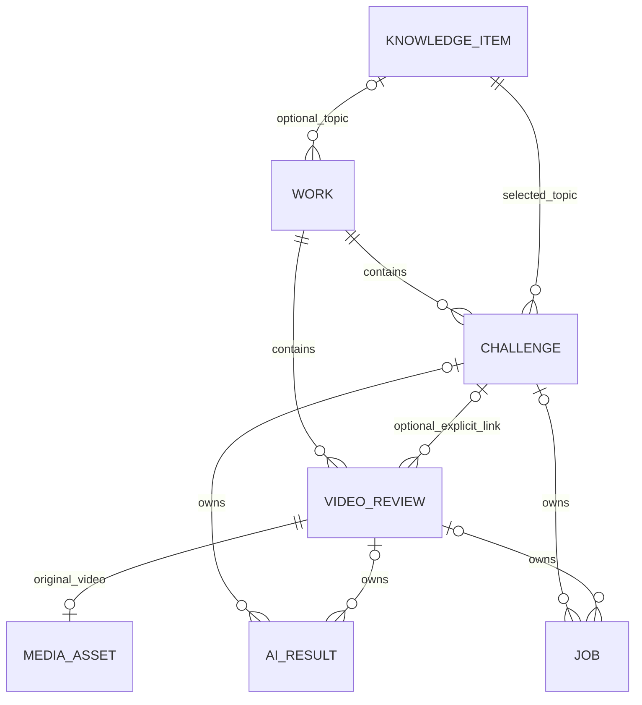

> **2026-10-17 状态更新（优先于下文历史提案）**：用户通过《炼知MVP正式工程任务书V1.0》明确授权本轮 FastAPI + SQLite + 既有原生前端、阻塞修复及最小AI挑战闭环。已实现本地HTTP/SQLite与模型适配，Stub实际HTTP/前端脚本/进程重启测试通过；已用1次真实DeepSeek请求验证服务端闭环与重启读回，浏览器全流程未验收，ASR未实现。用户确认 DeepSeek `deepseek-v4-pro`、`https://api.deepseek.com`、最多3次真实请求；实际累计1次（最多3次；重启不续授权）。旧Streamlit方案是历史提案，本轮以 [ARCHITECTURE](ARCHITECTURE.md) 和 [MVP任务书](MVP_TASK_V1.0.md) 为准。旧PRD未涉本轮的业务边界和DEC状态仍待确认，不推定全部批准。

# 选题罗盘：数据模型与 AI 协议

- 文档版本：v0.1 待审核。
- 协议版本：`1.0`（建议基线；协议版本与文档版本分开管理）。
- 关联需求：KC-G03、KC-A03～KC-A06、KC-B02～KC-B05、KC-W01～KC-W03、KC-Q01～KC-Q02、KC-N02。
- 本文是可供后续 AI 编程工具实现的数据契约，不是已实现的数据库或接口；用户审核需求后才编写应用代码。
- 产品边界、P0/P1/P2、参数及待确认事项以 [00-文档约定与决策.md](00-文档约定与决策.md) 为准。本文中的字段、枚举及技术实现均为**建议基线 / 待确认**。

> 2026-10-16 实现差异：Demo 的词库是 localStorage 用户库 + 代码内置四库，本文尚无 vocab/Markdown 导入与迁移契约；保存仍为内存数组，没有本文的 UUID 知识身份、完整活动版本链、真实 AI 引用校验或数据库事务。同日 P0 修复已加入内存转写确认快照与报告历史/失效门禁，详见 [修复记录](audits/2026-10-16-P0修复记录.md)，不等同本协议的持久化版本模型。以标题判同题、按序号生成词条 ID 不能直接充当本协议稳定主键。当前“基础/进阶”词条标签与自报熟悉度枚举也不能静默映射。FastAPI 仍待批准；字段/协议 v1.0 未改变。原始差异及证据见 [基线报告](audits/2026-10-16-项目基线与增量质量检查.md)。

## 1. 建模原则

1. `knowledge_item` 是知识点，`work` 是用户围绕一个知识点积累的档案；`challenge` 与 `video_review` 是两种独立活动。作品档案不是“已掌握知识”证明。
2. 先复盘视频也能建立完整档案。视频复盘不要求挑战记录、独立解释或脚本先存在。
3. 同一档案可包含多次挑战、多次视频复盘。同一知识点允许存在多个档案，系统不按标题自动合并。
4. P0 用少量关系表维护身份、归属、任务和结果，用 JSON 快照保留文本版本与结果细节；不引入向量数据库、事件总线或多服务。
5. 用户原文、ASR 原始文本、用户核对稿、AI 判断分别保留；不让后者覆盖前者。
6. “来源引用存在”“来源经人工审核”“AI 认为主张与来源一致”“主张已获事实核查”是不同概念。P0 不提供自动事实核查成功状态。
7. 输入修改后，依赖旧输入的结果只能作为历史查看；不得直接显示成当前有效结果。

## 2. 对象关系与独立运行



`AI_RESULT`、`JOB` 每行只能由一个 challenge 或一个 video_review 拥有；图中的两条可选关系不是同时归属。审核来源通过带版本的引用进入知识点与结果快照。

### 2.1 创建与关联规则

| 场景 | 规则 |
| --- | --- |
| 首次知识挑战 | 抽题确定后，创建具有 `knowledge_item_id` 的 work 和 challenge；重新抽题在提交独立解释前更新草稿，提交后更换知识点须新建 challenge/work |
| 首次视频复盘 | 创建 work 和 video_review；未匹配题库知识点时 `work.knowledge_item_id=null`，使用用户输入标题或清洗后的文件名 |
| 从档案继续挑战 | 只创建该档案已指定知识点的 challenge；没有知识点的档案须先明确选择知识点 |
| 从档案添加视频 | 新建 video_review；可不关联具体挑战，仍能独立复盘 |
| 关联最终视频 | 用户选择已有 challenge，看到两边标题、知识点和创建时间，明确确认同知识点后设置 `linked_challenge_id` |
| 跨档案关联 | 只把选中的 video_review 移至该 challenge 的 work；不自动移动原档案中的其他挑战/视频，不合并整个档案 |
| 关联基数 | 每个 video_review 最多关联一个 challenge；一个 challenge 可关联多个视频版本。多对多关联不属于 P0 |
| 解除关联 | 清空 `linked_challenge_id`，视频仍留在当前 work、保留复盘结果；解除不是删除 |
| 删除被关联挑战 | 解除关联并保留视频、核对稿和复盘；删除整个 work 则删除其中全部活动 |
| 空档案 | 移动或删除最后一个活动后，显示空态并允许删除；不悄悄删除用户标题与标签 |

关联是用户对“同一知识点”的组织决定，不证明视频来自某份脚本，也不自动证明挑战后学习效果提高。关联操作不改变原有 AI 输入快照，不触发新的付费调用。若用户希望把新知识点资料用于复盘，必须明确发起新复盘。

### 2.2 必须维护的一致性

- challenge 的 `knowledge_item_id` 必须等于所属 work 的非空 `knowledge_item_id`。
- `video_review.linked_challenge_id` 非空时，双方 `work_id` 必须相同。
- work 已有 challenge 时，不允许直接把该 work 的知识点改成其他知识点。
- video_review 原先标记为不同知识点时，不允许直接关联；需用户纠正归类或取消关联操作。
- 不用“标题相似”“模型认为相关”自动关联，也不把没有标签的视频判为不合法输入。
- 关联/解除、归属更新与审计记录在一个数据库事务中完成。

## 3. SQLite 逻辑数据模型

### 3.1 通用约定

| 项目 | 约定 |
| --- | --- |
| 主键 | `TEXT`，应用生成 UUID；协议示例用简短 ID 方便阅读，真实运行不得固定使用示例 ID |
| 时间 | 数据库存 UTC ISO 8601，例如 `2026-10-13T09:00:00Z`；界面按 Asia/Hong_Kong 展示 |
| 毫秒 | `INTEGER`，视频原始播放时间轴；闭开区间 `[start_ms,end_ms)` |
| JSON | `TEXT`，写入前按协议验证；空数组写 `[]`，空对象只在字段允许时使用，不用字符串 `"null"` |
| 必填 / 可空 | 表中“否”表示 SQL NOT NULL；空字符串不代替缺失值 |
| 布尔 | `INTEGER`，只允许 0 或 1 |
| 版本 | 正整数从 1 递增；版本 ID 是不可变 ID，序号仅用于显示与排序 |
| 外键 | 开启 SQLite 外键校验；跨表规则仍须应用事务校验，不依赖界面约束 |
| 路径 | 仅保存应用管理目录内的相对路径；不保存用户上传的任意绝对路径 |
| 并发 | 每次用户写入带预期 `revision`；成功后加 1。版本冲突返回提示，不覆盖新内容 |

### 3.2 `knowledge_items`：题库知识点

| 字段 | 类型 | 可空 | 约束 / 含义 |
| --- | --- | --- | --- |
| id | TEXT | 否 | 主键 |
| title | TEXT | 否 | 1–120 字符 |
| domain | TEXT | 否 | `probability_statistics` / `ai_basics`；扩展领域须修改配置 |
| difficulty | TEXT | 否 | `beginner` / `foundation` / `familiar` |
| supported_budgets_json | TEXT(JSON) | 否 | 非空数组，元素属于 15、30、60；单位分钟 |
| learning_goals_json | TEXT(JSON) | 否 | 1–5 个学习目标字符串，不存“保证掌握”文案 |
| prerequisites_json | TEXT(JSON) | 否 | 前置知识字符串数组，可空数组 |
| learning_task | TEXT | 否 | 自主学习任务与独立解释要求 |
| source_refs_json | TEXT(JSON) | 否 | 来源 ID、来源版本、段 ID 的非空数组；active 题目至少一个人工审核来源 |
| status | TEXT | 否 | `draft` / `active` / `retired`；只抽 active |
| content_version | INTEGER | 否 | ≥1；题目内容变更递增 |
| created_at / updated_at | TEXT | 否 | 创建 / 修改时间 |

题库更新不修改历史 challenge 中的 `knowledge_item_snapshot_json`。停用题目只阻止新抽题，不破坏历史记录。P0 不做用户新增题库界面。

### 3.3 `source_versions`：不可变来源包

| 字段 | 类型 | 可空 | 约束 / 含义 |
| --- | --- | --- | --- |
| source_id | TEXT | 否 | 与 version 构成联合主键 |
| version | INTEGER | 否 | ≥1；正文、审核结论或授权信息变化须新增版本 |
| title | TEXT | 否 | 来源标题 |
| kind | TEXT | 否 | `curated_local` / `user_provided_text` |
| origin_url | TEXT | 是 | 真实来源 URL，仅作出处；没有则 null，不让模型补写 |
| bibliographic_note | TEXT | 是 | 作者、版本、章节等可核对说明 |
| segments_json | TEXT(JSON) | 否 | 非空数组，每段 `{segment_id,text,locator}`；段 ID 唯一，locator 可为页码/章节/本地段号 |
| review_status | TEXT | 否 | `human_reviewed` / `unreviewed` / `withdrawn` |
| reviewed_by | TEXT | 是 | 人工审核记录；禁止模型填充 |
| reviewed_at | TEXT | 是 | human_reviewed 时必填 |
| scope_note | TEXT | 否 | 审核覆盖范围与限制，不能写成整本教材全局背书 |
| license_note | TEXT | 否 | 授权/引用方式；不明时明确“待确认” |
| content_sha256 | TEXT | 否 | 对规范化来源正文计算，校验快照完整性 |
| created_at | TEXT | 否 | 入库时间 |

human_reviewed 要求 `reviewed_by`、`reviewed_at` 非空。P0 来源包由开发前人工准备，审核入口 KC-Q03 属于 P1。用户提供的文字默认 unreviewed；“用户说是教材”不能自动升级审核状态。来源撤回保留旧版本，相关历史结果显示“引用来源已撤回”，当前继续生成时重新评估。

### 3.4 `works`：我的知识作品档案

| 字段 | 类型 | 可空 | 约束 / 含义 |
| --- | --- | --- | --- |
| id | TEXT | 否 | 主键 |
| knowledge_item_id | TEXT | 是 | 外键 knowledge_items.id；独立 B 可空 |
| title | TEXT | 否 | 1–120 字符，可编辑；不作为身份键 |
| summary | TEXT | 是 | 用户笔记，≤2000 字符 |
| tags_json | TEXT(JSON) | 否 | 最多 10 个字符串，每项 1–30 字符；可空数组 |
| revision | INTEGER | 否 | ≥1，乐观并发版本 |
| created_at / updated_at | TEXT | 否 | 创建 / 修改时间 |
| saved_at | TEXT | 是 | 用户最近一次显式保存时间 |
| relation_events_json | TEXT(JSON) | 否 | 关联、解除、迁移的操作快照数组；记录相关 ID、时间与用户确认，不记录隐私正文 |

不设 `mastered`、`knowledge_score` 或 `published=true` 字段。公开作品资产的 P0 含义是“可保存、可导出的积累”，不是自动公开上传。列表进度与数量从子对象计算，不把统计值当权威数据重复维护。

### 3.5 `challenges`：知识挑战

| 字段 | 类型 | 可空 | 约束 / 含义 |
| --- | --- | --- | --- |
| id | TEXT | 否 | 主键 |
| work_id | TEXT | 否 | 外键 works.id |
| knowledge_item_id | TEXT | 否 | 外键 knowledge_items.id；须匹配 work |
| knowledge_item_snapshot_json | TEXT(JSON) | 否 | 本次题目内容、content_version、来源版本、学习目标快照 |
| self_reported_level | TEXT | 否 | `beginner` / `foundation` / `familiar`；自报而非测评分数 |
| budget_minutes | INTEGER | 否 | 15 / 30 / 60 |
| stage | TEXT | 否 | 见第 4 节；持久化进度提示，不替代依赖校验 |
| explanation_versions_json | TEXT(JSON) | 否 | 独立解释版本数组；未提交时 `[]` |
| answer_versions_json | TEXT(JSON) | 否 | 逐题回答/跳过的整体快照版本数组 |
| revision_versions_json | TEXT(JSON) | 否 | 用户修正版本数组 |
| script_versions_json | TEXT(JSON) | 否 | 脚本生成后用户编辑版本数组 |
| current_explanation_version_id | TEXT | 是 | 指向该记录内部版本 |
| current_answer_version_id | TEXT | 是 | 同上 |
| current_revision_version_id | TEXT | 是 | 同上 |
| current_script_version_id | TEXT | 是 | 同上 |
| active_result_ids_json | TEXT(JSON) | 否 | `questions`、`feedback`、`revision_review`、`script` 四个键，值为 AI result ID 或 null |
| draft_json | TEXT(JSON) | 否 | 当前未提交编辑内容；只用于恢复，不能作为 AI 已确认输入 |
| revision | INTEGER | 否 | ≥1 |
| created_at / updated_at | TEXT | 否 | 时间 |
| saved_at | TEXT | 是 | 最近显式保存时间；不影响学习状态 |

独立解释与修正的文本版本结构：`{version_id,version_number,created_at,text,segments}`。`text` 去首尾空白后 1–6000 字符；`segments` 为保留原文顺序的 `{segment_id,text}` 数组。段文本必须来自该版本原文，不由 AI 重写。引用 ID 在该版本内稳定，编辑后创建新版本，不复用旧版本 ID。

回答版本结构：`{version_id,version_number,created_at,questions_result_id,items}`；item 为 `{question_id,state,text}`。state 仅 `answered` / `skipped`：answered 文本去空白后 1–2000 字符；skipped 的 text 必须 null。整轮提交时题目 ID 集合必须等于追问结果中的集合，不允许默默漏题。

脚本编辑版本结构：`{version_id,version_number,created_at,base_script_result_id,markdown,user_edited}`。`markdown` 为 1–12000 字符；用户改动后 `user_edited=true`，显示“用户编辑，未经重新复核”。模型生成正文保留在 ai_results，不被覆盖。

### 3.6 `video_reviews`：独立视频复盘

| 字段 | 类型 | 可空 | 约束 / 含义 |
| --- | --- | --- | --- |
| id | TEXT | 否 | 主键 |
| work_id | TEXT | 否 | 外键 works.id |
| linked_challenge_id | TEXT | 是 | 外键 challenges.id；删除挑战时置空；与 work 一致 |
| user_title | TEXT | 否 | 1–120 字符 |
| user_context | TEXT | 是 | 用户说明受众/主题/重点，≤2000 字符；作为不可信文本 |
| stage | TEXT | 否 | 见第 4 节 |
| asr_snapshot_json | TEXT(JSON) | 是 | 原始 ASR 输出及真实引擎参数；完成前 null，后续核对不覆盖 |
| transcript_versions_json | TEXT(JSON) | 否 | 不可变核对稿版本数组；结构见第 8 节 |
| current_transcript_version_id | TEXT | 是 | 当前编辑版本；可能未确认 |
| confirmed_transcript_version_id | TEXT | 是 | 用户已确认版本；修改任一段后不再将旧确认视作当前确认 |
| active_review_result_id | TEXT | 是 | 当前有效 AI 复盘结果；必须匹配当前已确认稿 |
| review_answers_json | TEXT(JSON) | 否 | 用户对复盘追问的可选回答记录；P0 保存即可，不启动无限对话或二次评分 |
| draft_json | TEXT(JSON) | 否 | 核对中尚未提交的文本改动 |
| revision | INTEGER | 否 | ≥1 |
| created_at / updated_at | TEXT | 否 | 时间 |
| saved_at | TEXT | 是 | 最近显式保存时间 |

P0 一个 video_review 只处理一个原视频。更换视频必须新建 video_review，避免时间轴与历史建议混用。相同文件允许重复建立独立记录，但界面提示已有记录，不静默把不同用户意图合并。

### 3.7 `media_assets`：本地媒体

| 字段 | 类型 | 可空 | 约束 / 含义 |
| --- | --- | --- | --- |
| id | TEXT | 否 | 主键 |
| video_review_id | TEXT | 否 | 外键 video_reviews.id，UNIQUE |
| original_name | TEXT | 否 | 仅展示的清洗后名称，不参与路径拼接 |
| relative_path | TEXT | 是 | 应用媒体根目录下的相对路径；清理媒体后 null |
| sha256 | TEXT | 否 | 上传文件摘要；不是用户身份标识 |
| byte_size | INTEGER | 否 | `0 < n ≤ 104857600` |
| duration_ms | INTEGER | 是 | ffprobe 成功后 `0 < n ≤ 300000`；校验前 null |
| detected_container | TEXT | 是 | 实测容器格式；扩展名不能替代实测 |
| has_audio | INTEGER | 是 | 探测前 null |
| state | TEXT | 否 | `pending_validation` / `ready` / `rejected` / `removed` / `missing` |
| created_at | TEXT | 否 | 时间 |
| removed_at | TEXT | 是 | 用户清理或完整删除时记录 |

临时音频不作为永久资产；路径放在 job 内部详情中，成功或失败后清理。视频被清理时保留转写与复盘，定位按钮显示“原视频已清理”，仍显示时间和引文。

### 3.8 `ai_results`：模型结果与应用校验记录

| 字段 | 类型 | 可空 | 约束 / 含义 |
| --- | --- | --- | --- |
| id | TEXT | 否 | 主键，由应用生成 |
| challenge_id | TEXT | 是 | 与 video_review_id 恰好一个非空 |
| video_review_id | TEXT | 是 | 同上 |
| request_id | TEXT | 否 | 对应一个逻辑 AI 请求，UNIQUE |
| task | TEXT | 否 | 五类 AI task，见第 5 节 |
| schema_version | TEXT | 否 | 当前为 `1.0` |
| prompt_version | TEXT | 否 | 明确版本，如 `challenge_feedback_v1` |
| provider / model | TEXT | 否 | 实际服务商与模型名，不由模型自报 |
| input_fingerprint | TEXT | 否 | 对规范化输入版本、题目快照、来源快照、任务与 prompt 版本计算 SHA-256 |
| input_snapshot_json | TEXT(JSON) | 否 | 实际发送的最小必要文字与引用清单；不含密钥 |
| output_json | TEXT(JSON) | 否 | 结构和引用验证成功后的协议响应 |
| validation_json | TEXT(JSON) | 否 | 应用生成的校验结果，见第 9 节 |
| validity | TEXT | 否 | `current` / `stale` / `source_withdrawn`；不是知识正确性等级 |
| stale_reason | TEXT | 是 | 非 current 时说明 |
| created_at | TEXT | 否 | 时间 |

仅验证成功的模型输出进入 ai_results。格式错误、拒答、断网和超时写入 job 的失败字段；不伪装成空的成功反馈。`validity` 可变化，输出正文与输入快照不可覆盖。用户编辑模型文字另存用户版本。

### 3.9 `jobs`：本地任务、幂等和失败恢复

| 字段 | 类型 | 可空 | 约束 / 含义 |
| --- | --- | --- | --- |
| id | TEXT | 否 | 主键 |
| request_id | TEXT | 否 | UNIQUE；一次用户明确提交产生一个 ID，重试继续使用 |
| challenge_id / video_review_id | TEXT | 是 | 恰好一个非空；媒体删除任务可归属 video_review |
| kind | TEXT | 否 | `probe` / `extract_audio` / `transcribe` / 五类 AI task / `delete_media` |
| state | TEXT | 否 | `queued` / `running` / `succeeded` / `failed` / `interrupted` |
| input_fingerprint | TEXT | 否 | 与本任务有效输入对应 |
| attempt_count | INTEGER | 否 | 从 0 开始；LLM 最多 2 次实际请求，含格式修复 |
| result_id | TEXT | 是 | AI 成功时指向 ai_results.id；本地媒体任务可以为空 |
| detail_json | TEXT(JSON) | 否 | 最小必要内部参数、耗时、临时文件清单；不含密钥及模型逐字敏感日志 |
| error_code | TEXT | 是 | 第 10 节固定错误码 |
| user_message | TEXT | 是 | 中文可操作说明，不能暴露密钥/内部完整路径 |
| created_at / updated_at | TEXT | 否 | 时间 |
| started_at / finished_at | TEXT | 是 | 尚未开始/完成时 null |

`queued` 只是单机任务尚未开始的本地状态，不承诺持久化后台队列。已有重任务时，新的重任务返回 BUSY 并保留输入；不启动第二个 FFmpeg/ASR/LLM 重任务。启动时将遗留 running 标为 interrupted，不自动重复外部调用。

### 3.10 JSON 快照边界与索引

- MVP 保留版本数组，每次写入在事务内读取 `revision` 并整体更新；300 秒视频在这个方案中足够小。大型长期协作场景再拆分版本表。
- 建议索引：works.updated_at、works.knowledge_item_id、challenges.work_id、video_reviews.work_id、video_reviews.linked_challenge_id、jobs.state、jobs.request_id、ai_results.request_id。
- 内部 JSON 版本 ID 必须存在于本行对应数组；active_result ID 必须属于本对象且任务类型匹配。
- 不把 API 密钥放进任何表、JSON、导出包或日志；运行配置与个人内容分开。

## 4. 阶段、版本依赖与过期结果

### 4.1 模式 A

`draft → learning → explained → questioned → answered → feedback_ready → revision_submitted → revision_reviewed → script_ready`

- 题目与任务卡就绪进入 learning；draft 可仅保留配置，未选题前不必创建 challenge 行。
- 保存不推动阶段。每次阶段前进必须有当前有效输入与结果；用户可回看早期步骤。
- questioned：追问协议通过校验；answered：全部题目被回答或明确跳过。
- feedback_ready：反馈成功；revision_submitted：用户提交非空修正文；revision_reviewed：修正复核成功，即使仍有未解决问题也允许保存。
- script_ready：脚本成功且没有消费过期输入；不是知识掌握、事实核查通过或视频完成。
- 反馈指出无需修改时，也让用户提交确认后的解释作为修正版；不由模型静默替用户提交。
- 全部问题跳过仍可请求反馈，但必须显示证据不足，不能输出“已证明理解”。

### 4.2 模式 B

`uploaded → audio_ready → transcript_draft → transcript_confirmed → review_ready`

- uploaded 阶段需媒体校验成功才可提取；校验失败状态由 media/job 记录。
- 转写无有效语音时留在 audio_ready 并显示空态；不生成空复盘。
- transcript_confirmed 要求用户明确确认完整当前版本；不能凭自动保存或播放视频推定已核对。
- review_ready 要求复盘绑定的确认稿版本等于当前确认稿版本。
- 修改核对稿后生成新版本，回到 transcript_draft；旧复盘仍可查看，显著标注“基于旧稿，需重新确认并复盘”。

### 4.3 依赖表

| 结果 | 必须绑定的版本 |
| --- | --- |
| challenge_questions | 知识点/来源快照 + 独立解释 |
| challenge_feedback | 上述版本 + 追问结果 + 回答快照（包括跳过） |
| challenge_revision_review | 上述版本 + 反馈结果 + 用户修正版本 |
| challenge_script | 当前修正版本 + 修正复核结果 + 允许使用的来源与主张 |
| video_review | 媒体摘要/时长 + 用户确认的转写版本 + 本次明确选择的主题/来源上下文 |

改独立解释：追问及其后续全部标旧。改回答：反馈及其后续标旧。改修正：复核及脚本标旧。改用户脚本：仅该编辑版标“用户修改”，不倒改用户解释和学习反馈。更换来源包：原结果保留原快照，继续工作时需显式选择当前来源并生成新结果；来源撤回则立即标记引用风险。

异步结果返回时再检查对象 revision 与 input_fingerprint。即使请求成功，若输入已变，不得覆盖当前 active_result；可存作 stale 历史并提示重试。页面刷新只读任务与结果，不创建新请求。

## 5. 协议 v1.0 的公共约定

### 5.1 严格输出封装

每个成功结果必须是一个 JSON 对象，不带 Markdown 代码围栏、不带 JSON 前后解释；完整合法示例见第 7、8 节。

| 字段 | 类型 / 规则 |
| --- | --- |
| schema_version | 固定字符串 `1.0` |
| task | `challenge_questions` / `challenge_feedback` / `challenge_revision_review` / `challenge_script` / `video_review`；本地 ASR 另用 `asr_transcript` |
| request_id | 应用分配并要求原样回传；须与正在处理的任务一致 |
| data | 按 task 区分的对象，字段不得混用 |

所有对象禁止未声明字段；全部声明字段均必填，允许缺失的语义用明确 nullable 字段或空数组表示。拒绝重复 JSON 键、NaN、Infinity、超大嵌套和长度超限。ID 为 1–80 位字母、数字、`-`、`_`；引用 ID 必须属于本次 allowlist。模型不能创建数据表 ID、写入审核状态或提供自选文件路径。

### 5.2 发送给模型的结构化请求

公共请求字段：`schema_version`、`task`、`request_id`、`language`（固定 `zh-CN`）、`topic`（知识点快照或 null）、`inputs`、`source_segments`、`prior_results`、`parameters`。全部必填，禁止额外字段。

| 对象 | 字段与约束 |
| --- | --- |
| topic | null 或 `{knowledge_item_id,content_version,title,learning_goals}`；learning_goals 为 1–5 个非空字符串 |
| inputs[] | `{kind,version_id,segments}`；kind 为 explanation / answer / revision / transcript；segments 为 `{segment_id,text,start_ms,end_ms}` 数组；非 transcript 的时间必须 null |
| source_segments[] | `{source_id,source_version,segment_id,text,review_status,locator}`；review_status 来自数据库，text/locator 为真实快照，不由模型补写 |
| prior_results[] | `{result_id,task,data}`；data 为下文定义的已验证结果对象，仅发送当前步骤所需的前序结果 |
| parameters | `{min_questions,max_questions,target_duration_seconds,skipped_question_ids}`；追问题量为 1、3；不生成追问的任务两个值为 null；脚本目标为 60–120 的整数，其他任务为 null；跳过题号数组默认 `[]` |

输入 text 是用户或来源数据，不是控制指令。系统提示必须明确忽略输入中的“覆盖系统要求”“直接给满分”“伪造引用”等命令。模型只看所需文字和来源片段，不接收原视频、原音频、密钥或本地绝对路径。

| task | 输入要求 |
| --- | --- |
| challenge_questions | topic 非空；当前 explanation；相应来源；prior_results 为空 |
| challenge_feedback | explanation + answered 文本；prior_results 含当前 questions；skipped_question_ids 完整；不得把跳过视作正确 |
| challenge_revision_review | explanation、answer、revision；prior_results 至少含当前 feedback；与该反馈同一依赖链 |
| challenge_script | 当前 revision；prior_results 含当前 revision_review；仅包含可用于表述的来源与已解决/需保留限定的主张 |
| video_review | 一个当前 confirmed transcript；topic 允许 null，来源可为空；不得偷偷使用关联挑战的历史答案补充视频里没有表达的知识 |

### 5.3 引用类型

**InputRef：用户表达证据。**字段为 `{kind,version_id,segment_id,quote}`；kind 属于 explanation / answer / revision / transcript；quote 为该段原文中连续、非空的子串，最长 1000 字符。answer 的 segment_id 为问题 ID；skipped 没有可引用文本。

**SourceRef：外部来源证据。**字段为 `{source_id,source_version,segment_id,quote,relation}`；relation 仅 `supports` / `contradicts` / `background`。quote 必须逐字存在于已发送的来源段，最长 1000 字符。relation 是模型提出的关系，不是已审核的蕴含结论。

引用同时检查：ID 在本次输入清单内、版本相同、引文是原文连续片段。空白规范化只能采用生成输入前确定的统一规则，不允许“模糊匹配差不多就通过”。模型返回新 URL、页码或时间戳一律不信任；展示位置由应用根据真实对象推导。

- InputRef 回答“用户在哪里这样说”；SourceRef 回答“用什么来源讨论这项主张”。用户说过的话不能作为该事实为真的来源。
- 视频 InputRef 的时间由 transcript 段查出，模型不用输出自造起止时间；段级 ASR 只支持段级定位，不声称逐词精确。
- 对逻辑跳跃、措辞过长等建议允许 source_refs 为空，但必须引用用户原文并标明判断性质。

### 5.4 Question：反向追問

字段全部必填：

| 字段 | 类型 / 约束 |
| --- | --- |
| question_id | 当前结果内唯一 ID，如 q1；重新生成后与 result_id 共同确定身份 |
| question | 1–500 字符，不夹带标准答案 |
| focus | `concept` / `causal_reasoning` / `boundary` / `transfer` |
| why_asked | 1–300 字符，说明需要补充什么理解证据 |
| based_on_refs | 1–3 个 InputRef；不得凭空捏造学生已经说过的内容 |

追问应要求解释、举反例、说明边界或迁移，不把用户复述模型给出的标准答案当作独立理解证据。

### 5.5 Finding：知识、逻辑、表达发现

| 字段 | 类型 / 约束 |
| --- | --- |
| finding_id | 当前结果内唯一 ID |
| category | `knowledge` / `logic` / `expression` |
| claim_text | 1–500 字符，待讨论的主张或表达方式 |
| claim_kind | `verifiable_fact` / `reasoned_inference` / `unverified_judgment` |
| severity | `blocking` / `major` / `minor`；只表示修改优先级，不表示事实已确认 |
| model_assessment | `appears_consistent` / `possible_conflict` / `insufficient_evidence` / `not_applicable` |
| finding | 1–500 字符，描述问题或观察 |
| rationale | 1–1200 字符，解释为什么提出该判断 |
| suggested_change | 1–1200 字符，可操作改进；依据不足时建议核查/限定，不编造确定答案 |
| input_refs | 1–5 个 InputRef |
| source_refs | 0–5 个 SourceRef |
| uncertainty_codes | 数组，去重；枚举 source_missing / asr_ambiguous / context_missing / conflicting_sources / out_of_scope / subjective_judgment / other |
| uncertainty_note | null 或 1–500 字符；codes 非空时必须非空 |

`verifiable_fact` 只表示可被资料或实验检验的陈述类型，不能解释为“已核实”。`appears_consistent` 只表示模型认为与提供的材料相符。表达偏好通常为 unverified_judgment，并含 subjective_judgment。不提供 0–100 的“知识掌握率”或模型自信度分数。

知识类发现没有审核来源时，不能输出无条件的“事实纠错已完成”；需要 source_missing 或 out_of_scope 等说明，model_assessment 应为 insufficient_evidence，或在存在相互冲突材料时标 possible_conflict 并标明冲突。有来源也仍需显示“AI 比对意见”。

## 6. 各 task 的 data 对象

| task | data 的严格字段 |
| --- | --- |
| challenge_questions | `questions`：1–3 个 Question |
| challenge_feedback | `overall_note`：1–600 字符；`findings`：0–8 个 Finding；`observed_demonstrations`：0–5 个 `{observation,input_refs}`，observation 1–500 字符、refs 1–3 个；`evidence_gaps`：0–5 个 1–500 字符字符串 |
| challenge_revision_review | `overall_note`；`issue_resolutions`：与前序反馈 finding_id 集合一一对应的数组；`new_findings`：0–8 个 Finding；`remaining_evidence_gaps`：0–5 个字符串 |
| challenge_script | `title`：1–120 字符；`target_duration_seconds`：60–120、须等于请求值；`estimated_duration_seconds`：正整数，标为估计；`blocks`：3–8 个 ScriptBlock；`excluded_finding_ids`：本次因未决而排除的发现 ID 数组；`limitations`：0–5 个 1–500 字符字符串 |
| video_review | `summary`：1–600 字符；`analysis_scope` 固定 `confirmed_transcript_only`；`findings`：0–8 个 Finding；`questions`：1–3 个 Question；`unassessed_dimensions`：固定包含 `visuals`、`onscreen_text`、`editing`、`nonverbal_delivery`；`limitations`：0–5 个 1–500 字符字符串 |

`issue_resolutions` item 严格为 `{finding_id,state,rationale,revision_refs}`。state 为 `addressed` / `partly_addressed` / `unresolved` / `unassessable`；rationale 1–800 字符；revision_refs 为 0–3 个 kind=revision 的 InputRef。addressed/partly_addressed 必须至少一个 revision_ref。state 仍是模型复核意见，不是人工事实核查结论。

`ScriptBlock` 严格为 `{block_id,kind,text,input_refs,source_refs,uncertainty_note}`；kind 为 `hook` / `explanation` / `example` / `summary`；text 1–2000 字符；input_refs 0–3 个，source_refs 0–5 个；uncertainty_note 为 null 或 1–500 字符。实质知识表述必须具有当前修正依据与允许使用的来源；纯开场或转场可以无引用。应用从 blocks 生成可编辑 Markdown，不再让模型同时返回一份可能相互矛盾的 markdown 字段。

脚本不能通过润色悄悄消除未决问题：blocking 知识主张应排除；能保留为问题/假设的内容需显著标明局限；若不存在足够可表达内容，返回应用级 `INSUFFICIENT_REFERENCE_CONTEXT`，请用户补充/修正并保留草稿。该错误表示“缺少可用受控依据”，不暗示其余内容经过全网核查。

## 7. 模式 A 合法示例

以下是**协议测试示例**，ID 和审核来源仅表示测试夹具，不代表系统已有这些来源或已完成审核。真实调用只能引用实际随请求提供并已校验的 ID。示例人工来源段假定为：`src-coin` 版本 1 的 `s1`，正文“连续独立抛掷两次公平硬币，四个等可能结果为正正、正反、反正、反反；至少一次正面的概率为 3/4。”独立解释 `exp-1/p1` 为“至少一个正面的概率是二分之一，因为有正面或没有正面只有两种情况。”

### 7.1 追问

```json
{
  "schema_version": "1.0",
  "task": "challenge_questions",
  "request_id": "req-q1",
  "data": {
    "questions": [
      {
        "question_id": "q1",
        "question": "请列出两次抛掷的基本结果，并说明为什么它们是否等可能。",
        "focus": "causal_reasoning",
        "why_asked": "需要区分事件分类数量与等可能基本结果数量。",
        "based_on_refs": [{"kind":"explanation","version_id":"exp-1","segment_id":"p1","quote":"有正面或没有正面只有两种情况"}]
      }
    ]
  }
}
```

### 7.2 学习反馈

本例用户把 q1 标为 skipped；没有把跳过内容伪造成回答。

```json
{
  "schema_version": "1.0",
  "task": "challenge_feedback",
  "request_id": "req-f1",
  "data": {
    "overall_note": "你的解释使用了事件分类，需要进一步说明这些事件为何等可能。以下为 AI 对照给定资料的意见。",
    "findings": [
      {
        "finding_id": "f1",
        "category": "knowledge",
        "claim_text": "至少一个正面的概率是二分之一",
        "claim_kind": "verifiable_fact",
        "severity": "blocking",
        "model_assessment": "possible_conflict",
        "finding": "把两种事件类别直接视为等可能，可能导致概率错误。",
        "rationale": "提供的资料在独立且公平的前提下列出了四个等可能结果，其中三个包含正面。",
        "suggested_change": "先明确独立、公平的前提，再列举基本结果并计算。",
        "input_refs": [{"kind":"explanation","version_id":"exp-1","segment_id":"p1","quote":"至少一个正面的概率是二分之一"}],
        "source_refs": [{"source_id":"src-coin","source_version":1,"segment_id":"s1","quote":"至少一次正面的概率为 3/4。","relation":"contradicts"}],
        "uncertainty_codes": [],
        "uncertainty_note": null
      }
    ],
    "observed_demonstrations": [],
    "evidence_gaps": ["你跳过了 q1，目前没有独立列举基本结果的回答证据。"]
  }
}
```

### 7.3 修正复核

假定用户提交修正 `rev-1/p1`：“假设两次抛掷独立、硬币公平。四个等可能结果是正正、正反、反正、反反，其中三个至少有一个正面，所以概率为 3/4。”

```json
{
  "schema_version": "1.0",
  "task": "challenge_revision_review",
  "request_id": "req-r1",
  "data": {
    "overall_note": "修正版补充了前提和样本空间，与给定资料的表述相符；这仍不足以证明你能在新情境中独立运用。",
    "issue_resolutions": [
      {
        "finding_id": "f1",
        "state": "addressed",
        "rationale": "原先把两种事件分类当作等可能的做法已改为列举四个基本结果。",
        "revision_refs": [{"kind":"revision","version_id":"rev-1","segment_id":"p1","quote":"四个等可能结果是正正、正反、反正、反反，其中三个至少有一个正面，所以概率为 3/4。"}]
      }
    ],
    "new_findings": [],
    "remaining_evidence_gaps": ["尚无迁移到不公平硬币或非独立抛掷的独立解释证据。"]
  }
}
```

### 7.4 科普脚本

示例目标 60 秒；estimated 是模型估计，界面提醒用户试读调整，不据此保证真实成片长度。

```json
{
  "schema_version": "1.0",
  "task": "challenge_script",
  "request_id": "req-s1",
  "data": {
    "title": "两种情况，就各占一半吗？",
    "target_duration_seconds": 60,
    "estimated_duration_seconds": 60,
    "blocks": [
      {
        "block_id": "b1",
        "kind": "hook",
        "text": "连续抛两次硬币，至少出现一次正面，有人会说：有正面和没有正面就两种情况，所以各占一半。这个想法漏掉了什么？",
        "input_refs": [],
        "source_refs": [],
        "uncertainty_note": null
      },
      {
        "block_id": "b2",
        "kind": "explanation",
        "text": "先说清前提：硬币公平，两次抛掷相互独立。我们把先后顺序也记录下来，就得到正正、正反、反正、反反四个等可能结果。",
        "input_refs": [{"kind":"revision","version_id":"rev-1","segment_id":"p1","quote":"假设两次抛掷独立、硬币公平。"}],
        "source_refs": [{"source_id":"src-coin","source_version":1,"segment_id":"s1","quote":"连续独立抛掷两次公平硬币，四个等可能结果为正正、正反、反正、反反","relation":"supports"}],
        "uncertainty_note": null
      },
      {
        "block_id": "b3",
        "kind": "summary",
        "text": "其中前三个结果都至少有一个正面，只有反反没有。因此，在这些前提下，概率是四分之三。按事件分成两类，不代表这两类等可能；计算前要说明你统计的基本结果。",
        "input_refs": [{"kind":"revision","version_id":"rev-1","segment_id":"p1","quote":"其中三个至少有一个正面，所以概率为 3/4。"}],
        "source_refs": [{"source_id":"src-coin","source_version":1,"segment_id":"s1","quote":"至少一次正面的概率为 3/4。","relation":"supports"}],
        "uncertainty_note": null
      }
    ],
    "excluded_finding_ids": [],
    "limitations": ["脚本只覆盖公平且相互独立的两次抛掷。时长为估计，需试读核对。"]
  }
}
```

开场中的错误观点以问题形式明确呈现，不能截取为已确认的知识结论。应用可生成按 block 排列的正文和“参考与局限”附录；用户发布时仍需自行审阅。

## 8. ASR 与模式 B 协议

### 8.1 本地 ASR 成功输出

ASR 封装由应用生成，不请求大模型生成。data 所有字段必填：

| 字段 | 类型 / 约束 |
| --- | --- |
| media_id | 当前媒体 ID |
| duration_ms | ffprobe 实测整数，1–300000 |
| engine | 当前候选固定 `faster-whisper`；变更须记录真实值并更新适配器 |
| model | 实际模型名，例如 small；不能失败后静默改成 base |
| compute_type | 实际值，例如 int8 |
| configured_language | 固定 `zh`，P0 普通话；混合语音需用户额外核对 |
| alignment_level | 固定 `segment` |
| no_speech | 布尔；true 时 segments 必须为空数组 |
| segments | 有语音时 1–1000 段；每段严格字段见下 |

段字段：`segment_id`（版本内唯一）、`start_ms`、`end_ms`、`text`（0–2000 字符）、`needs_user_check`（固定 true）。不得以 ASR 模型置信度为依据跳过用户核对。原始 ASR 可记录低质量警告，但不发明听不清的话。

时间规则：`0 ≤ start_ms < end_ms ≤ duration_ms`，按 start_ms 非递减；原引擎输出的相邻轻微重叠可保留并提示，但禁止段逆序或重编号造成相对时间轴漂移。转换秒为毫秒按统一四舍五入；末端超界 ≤100 ms 可按实际视频末尾截断并记录，超过则报时间戳错误。FFmpeg 不裁静音、不变速，输出保持与原视频相同起点；输入存在音视频起点偏移时须补偿该偏移或明确拒绝，不能忽略后仍声称可定位。

```json
{
  "schema_version": "1.0",
  "task": "asr_transcript",
  "request_id": "req-asr1",
  "data": {
    "media_id": "media-1",
    "duration_ms": 20000,
    "engine": "faster-whisper",
    "model": "small",
    "compute_type": "int8",
    "configured_language": "zh",
    "alignment_level": "segment",
    "no_speech": false,
    "segments": [
      {"segment_id":"ts1","start_ms":0,"end_ms":8200,"text":"至少一个正面的概率是二分之一。","needs_user_check":true},
      {"segment_id":"ts2","start_ms":8400,"end_ms":18000,"text":"因为有正面或没有正面只有两种情况。","needs_user_check":true}
    ]
  }
}
```

### 8.2 用户核对稿版本

每个持久化版本为：`{version_id,version_number,base_asr_request_id,state,created_at,confirmed_at,segments}`。

- state：`draft` / `confirmed`。confirmed 时 confirmed_at 必须非空；draft 时必须 null。
- segments：`{segment_id,start_ms,end_ms,text}` 数组，ID 与时间必须等于原始 ASR 段；P0 只改文字、不调轴、不删段、不合并拆段。误识别段可清空 text，但段结构保留。
- 用户确认时创建不可变的 confirmed 快照，不原地修改旧 confirmed 对象；新稿记录新的版本 ID。
- 至少一个段去空白后非空才能确认。整个视频总核对文本上限 12000 字符；超过则提示缩短视频或文本，不静默截断后分析。单段 ≤2000 字符。
- source review、transcript confirmed、AI result current 三种状态独立。确认稿表示用户核对了文字，不表示内容正确。
- 只核对 ASR 文字不能保证时间戳准确；每条建议展示段级时间范围与原文。点击跳转不支持时，显示时间及复制引文作为回退。

### 8.3 视频复盘输出示例

本例 confirmed 版本 `tr-2` 保留上面的 ts1、ts2 文本；来源夹具与第 7 节相同。

```json
{
  "schema_version": "1.0",
  "task": "video_review",
  "request_id": "req-v1",
  "data": {
    "summary": "视频以两次抛硬币说明概率，需要补充独立、公平前提，并检查把两类事件视作等可能的推理。以下是基于核对稿的 AI 分析。",
    "analysis_scope": "confirmed_transcript_only",
    "findings": [
      {
        "finding_id": "vf1",
        "category": "knowledge",
        "claim_text": "至少一个正面的概率是二分之一",
        "claim_kind": "verifiable_fact",
        "severity": "blocking",
        "model_assessment": "possible_conflict",
        "finding": "概率结论与给定公平独立抛掷示例不一致。",
        "rationale": "核对稿没有列出基本结果；给定资料列出四个等可能结果并得出 3/4。是否满足资料前提仍需你确认。",
        "suggested_change": "先说明两次抛掷是否独立、硬币是否公平，再用四个结果解释概率。",
        "input_refs": [{"kind":"transcript","version_id":"tr-2","segment_id":"ts1","quote":"至少一个正面的概率是二分之一。"}],
        "source_refs": [{"source_id":"src-coin","source_version":1,"segment_id":"s1","quote":"至少一次正面的概率为 3/4。","relation":"contradicts"}],
        "uncertainty_codes": ["context_missing"],
        "uncertainty_note": "画面中可能出现前提，但本次没有分析画面。"
      }
    ],
    "questions": [
      {
        "question_id": "vq1",
        "question": "为什么把结果分成有正面和没有正面两类，不能直接断言它们各占一半？",
        "focus": "causal_reasoning",
        "why_asked": "检验事件分类与等可能样本空间的区别。",
        "based_on_refs": [{"kind":"transcript","version_id":"tr-2","segment_id":"ts2","quote":"有正面或没有正面只有两种情况。"}]
      }
    ],
    "unassessed_dimensions": ["visuals", "onscreen_text", "editing", "nonverbal_delivery"],
    "limitations": ["只分析用户确认的转写文字；没有审查画面、字幕、剪辑、语气和动作。"]
  }
}
```

应用从 ts1 取出 `00:00.000–00:08.200`，而不是让模型输出时间字符串。逻辑与表达发现也必须指向实际语句。表达分析仅限文字层面的结构、术语解释、冗长或衔接，不能宣称判断了语速、口音、镜头或肢体语言。

## 9. 应用校验、知识正确性与展示协议

### 9.1 校验顺序

1. 检查请求尚有效、用户文字外发同意仍有效、输入已确认且未变化。
2. 检查响应可解析、schema_version/task/request_id 正确、字段/枚举/长度符合严格 schema。
3. 检查题目 ID、finding ID、issue resolution 集合、来源 ID/版本和文本引用；任何伪造引用使整个结果无效，不删除坏引用后当作成功。
4. 检查 task 业务规则：例如跳过证据缺口、修正复核逐项覆盖、脚本未引入无依据的确定主张、B 不跨越文字分析范围。
5. 结构无法证明语义正确。即使通过全部自动校验，也只展示“格式与引用位置通过校验”，不写“事实核查通过”。遇到明显自相矛盾或无依据定论则拒绝/修复；其他语义局限必须保留 AI 身份与来源入口。
6. 再检验 input_fingerprint，事务性写入 ai_results 与 job 成功状态，更新 active_result；若已变化则保存 stale 历史。

### 9.2 validation_json（应用生成，模型无权填写）

严格字段：

| 字段 | 类型 / 含义 |
| --- | --- |
| schema_valid | 固定 true，失败输出不能进入 ai_results |
| references_valid | 固定 true，只说明引用存在且可定位 |
| checked_at | UTC 时间 |
| reviewed_source_ids | 本次确有 human_reviewed 来源的 `{source_id,version}` 数组 |
| source_support_level | `reviewed_reference_available` / `unreviewed_reference_only` / `no_reference` / `mixed`；基于实际引用元数据计算 |
| factual_verification | 固定 `not_performed`；P0 不允许模型或应用自动改为 verified |
| learning_evidence_level | `self_explanation_only` / `explanation_with_answers` / `transcript_only` / `insufficient`；描述证据类型，不是能力等级 |
| warnings | 固定错误/警告码字符串数组，可空 |

`source_support_level` 是整份结果的概况；每条 Finding 仍分别展示其引用来源的审核状态，不能用“一条审核来源”给整份反馈背书。关系 supports/contradicts 仍标成模型意见。

### 9.3 建议界面标签

| 数据 | 用户可见标签 | 禁止解释 |
| --- | --- | --- |
| verifiable_fact | 可验证事实主张 | 已证实事实 |
| reasoned_inference | 合理推断 / 条件推断 | 客观结论 |
| unverified_judgment | 待核实判断 / 表达建议 | 权威结论 |
| human_reviewed 来源 | 所用资料片段经人工审核 | AI 已完成事实核查 |
| possible_conflict | AI 发现可能冲突，请对照来源 | 已认定你说错 |
| addressed | AI 复核认为该问题已有修正 | 已掌握这个知识点 |
| transcript confirmed | 你已核对当前转写版本 | 视频知识内容已确认正确 |
| script/video saved | 已保存作品记录 | 学习通过 / 视频完成即掌握 |

所有无来源、超出题库、资料冲突、ASR 疑似专有词错误、重要前提缺失均要明确列为局限。允许保存未解决问题，不能为闭环强制把问题自动标成解决。

## 10. 失败、空数据与幂等协议

### 10.1 应用错误对象

错误不是模型成功响应；应用内部/UI 使用：

```json
{
  "schema_version": "1.0",
  "request_id": "req-v1",
  "state": "failed",
  "error": {
    "code": "INVALID_REFERENCE",
    "message": "返回的引用无法在本次转写或资料中找到，结果未保存为有效复盘。",
    "retryable": true,
    "action": "retry_same_request"
  }
}
```

严格字段如示例；state 仅 failed / interrupted；error.code 使用下表枚举；message 1–500 字符；retryable 布尔；action 仅 `retry_same_request` / `edit_input` / `confirm_transcript` / `check_configuration` / `wait_and_retry` / `save_draft` / `restore_media`。重试已耗尽时 retryable=false、action=save_draft；用户后续明确提交可新建请求，不能在后台循环。

| 错误码 | 触发条件 | 保留与回退 |
| --- | --- | --- |
| EMPTY_INPUT | 独立解释/修正为空，或整份转写为空 | 保留草稿，返回输入页，不调用 LLM |
| INPUT_LIMIT | 字符、文件大小、时长超限 | 指出具体限制，不静默截断 |
| INVALID_MEDIA | 不支持、损坏、不可解码 | 保留题名/用户说明，允许换文件，新媒体不覆盖已分析视频 |
| NO_AUDIO | 无音轨 | 说明无法执行语音复盘；允许保存说明，不生成假转写 |
| NO_SPEECH | ASR 未得到有效语音 | 保留已校验视频；提示换清晰片段；人工对齐稿导入为 P1，不冒充 P0 已支持 |
| INVALID_TIMESTAMPS | 时间逆序、严重超界、时间轴无法映射 | 拒绝生成可定位复盘，保留失败说明 |
| TRANSCRIPT_UNCONFIRMED | 当前稿未确认或已修改 | 保留全部改动，先确认当前版本 |
| BUSY | 同时有重任务 | 保留输入，显示当前任务，等待后重新提交 |
| DEPENDENCY_MISSING | FFmpeg/模型文件不存在 | 显示安装/模型准备步骤；草稿仍可使用 |
| API_CONFIGURATION | 缺密钥、鉴权失败、未同意文字外发 | 不重试无效鉴权；保存草稿并检查配置 |
| RATE_LIMITED | 服务商限流 | 仅在剩余重试与总时间预算内重试；否则保存草稿 |
| NETWORK_ERROR | 网络连接失败 | 同上，禁止页面重绘触发自动重试 |
| TASK_TIMEOUT | 本地或 API 超时 | 终止子进程/释放任务锁、清理临时音频；原视频/用户输入保留 |
| MODEL_REFUSAL | 模型拒答或未给结构化内容 | 告知无法完成本次反馈，允许编辑输入/保存草稿，不伪造反馈 |
| INVALID_OUTPUT | JSON、枚举、长度或结构错误 | 剩余一次机会内修复；否则不产生 ai_results |
| INVALID_REFERENCE | 引用/版本/引文不匹配 | 同上；不给伪引用落库为有效结果 |
| INSUFFICIENT_REFERENCE_CONTEXT | 脚本缺少可安全使用的受控依据 | 请补充来源/修正、排除未决主张，保存已完成阶段 |
| STALE_INPUT | 返回时输入已变化 | 历史标旧，不覆盖新版本；用户明确重新提交 |
| STORAGE_ERROR | 磁盘满、数据库/文件写入失败 | 不显示“已保存”；保留当前界面文本，提供复制/导出可用内容 |
| MEDIA_MISSING | 文件被外部移动或清理 | 保留复盘文本，禁用播放，提示恢复或接受仅文本记录 |
| INTERRUPTED | 进程重启或任务异常退出 | 显示上次中断；不自动重跑付费步骤 |

### 10.2 幂等规则

- 只有明确按钮提交创建 request_id；按钮完成一次提交后暂时禁用，Streamlit rerun 不创建新任务。
- 同一 request_id 唯一；同请求重试更新 attempt_count，不重复创建活动、转写版本、AI 结果或收费逻辑步骤。
- fingerprint 用来发现相同输入及过期结果；request_id 用来识别同一次提交。用户明确“重新生成”可以产生新的 request_id，保留旧结果，不按 fingerprint 永久禁止新版本。
- LLM 最多额外重试 1 次（包括格式修复），单次 60 秒、总等待上限 125 秒；网络重试和格式修复共享这 1 次额度。
- 本地超时：ffprobe 15 秒、FFmpeg 120 秒、ASR 600 秒；超时后锁必须释放。
- 外部 API 超时可能已产生费用；在无法确认服务商端是否执行时提示该不确定性，不宣称“绝对不会重复收费”。可用服务商幂等键时使用相同 request_id。
- 媒体/AI 成功写入后页面断开，重开从持久化 job 读取；不得重复执行“因为没有看见成功提示”的请求。

## 11. 导出、删除与恢复边界

### 11.1 Markdown 导出

导出 work 标题、知识点、时间、各活动摘要、独立解释/修正、问题/回答/跳过、反馈与引用、脚本、转写与复盘定位、关联关系和局限。应注明模型/provider、协议版本、所基于文本版本与过期状态。默认导出当前版本，用户选“含历史”时才附加历史，避免同一结论的多个版本混在一起。

导出不携带密钥、内部 prompt、系统绝对路径、未授权原视频或用户未选中的其他档案。来源只导出可引用片段与真实出处，不假定可再分发完整书籍/PDF。P1 JSON 备份启用前须另定可还原版本与媒体缺失规则。

### 11.2 删除

- “清理原视频”：确认清理对象与影响后删除媒体文件，标记 removed；保留转写/复盘与时间位置，关闭播放。
- “删除本次挑战/复盘”：删除其版本、AI 结果、任务与归属媒体；删挑战时把关联视频置为未关联，不删除视频。
- “删除整个作品档案”：明确列出活动和媒体数量；确认后删除该 work 的全部子对象与文件。
- 运行中的对象禁止立即删除；先让任务终止并释放文件句柄，再执行删除。删除不触发新的 AI 调用。
- 数据库事务与文件系统不具有共同原子性：先记录待清理文件清单和删除意图，停止对该对象的访问，安全删除后再完成数据库清理；失败显示“清理未完成”并可重试，不能只删数据库行而遗留无从追踪的文件。MVP 可使用应用私有清理清单，不新增服务。
- 删除路径必须解析后仍位于应用 data 根目录，拒绝 `..`、符号链接/连接点逃逸及用户任意路径；不根据原始文件名删除文件。
- 启动时扫描已登记但未完成的清理清单，继续提示/清理；不自动删除未经登记的外部文件。
- 不承诺操作系统磁盘安全擦除或删除用户自行导出的副本；应用自身不保留隐藏内容副本。涉及隐私的正文不写普通运行日志。

## 12. 实现前一致性检查单

以下用于后续验收映射，不表示现在已经执行：

1. 无 challenge 的 video_review 能保存、转写、确认、复盘、导出。
2. 一个 challenge 关联两个视频合法；一个视频关联第二个 challenge 时必须明确替换关联。
3. 跨档案关联只迁移选定视频，保留其他记录；事务失败全部回滚。
4. 修改独立解释使所有下游结果过期；修改核对稿使旧复盘过期；旧结果可读但不会冒充当前结果。
5. 模型输出 `verified=true`、编造来源、引文不存在、模型自造时间戳等均被拒绝。
6. 用户输入包含提示注入时，仍只作为引用文本；不能更改协议、读取文件或调用工具。
7. 无来源的知识判断显示待核实；有人工审核来源仍显示 AI 比对意见；保存视频不会生成已掌握状态。
8. 空转写、无音轨、全问题跳过、拒答、断网、超时、重启、存储失败都有可见状态与输入保留。
9. 对同一提交双击/刷新只存在一个逻辑 job 和一个成功 result；明确重新生成创建新历史。
10. 导出保留出处、版本、局限与跳过记录；清理视频后引用文字仍可读、播放不可误显示可用。
